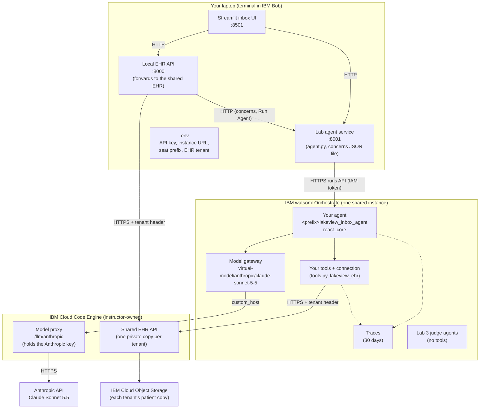

# Environment Topology

This page shows where each part of the TechXchange 2026 edition runs and how the parts talk to each other.

## High-level design

The UI, the local EHR API and the lab agent service run on each student's laptop. The agent, its tools and the judge agents run on one watsonx Orchestrate instance shared by the room. Each seat deploys under its own name prefix, for example `student0_`, which `scripts/ibm_cloud_login.py` derives from the seat's username.

Patient data comes from one shared EHR on IBM Cloud Code Engine. Each seat gets a private copy of the 12 patients. The tenant ID is a SHA-256 fingerprint of the seat's API key, so the EHR never sees the key itself. The EHR saves each copy to IBM Cloud Object Storage, so copies survive server restarts. The local EHR API forwards to the shared EHR with the same tenant, so the UI and the agent's tools see the same data.

The agent's model is Claude Sonnet 5.5. Orchestrate registers it as an Anthropic model whose `custom_host` is the model proxy on the same Code Engine service. The proxy checks Orchestrate's token, swaps in the real Anthropic key, and forwards the request. The Anthropic key stays on the server; it never reaches the laptops or Orchestrate.

---

## Communication map

| From | To | Protocol | Labs |
|---|---|---|---|
| Streamlit UI | Local EHR API | HTTP · `:8000` | All |
| Streamlit UI | Lab agent service | HTTP · `:8001` | All |
| Local EHR API | Lab agent service (concerns, runs) | HTTP · `:8001` | All |
| Local EHR API | Shared EHR (Code Engine) | HTTPS · 443, `X-Tenant` header | All |
| Lab agent service (`agent.py`) | watsonx Orchestrate runs API | HTTPS · 443, IAM bearer token | All |
| `deploy.py` (`orchestrate` CLI) | watsonx Orchestrate | HTTPS · 443 | 1, 2 |
| Agent tools (in Orchestrate) | Shared EHR (Code Engine) | HTTPS · 443, `X-Tenant` header | All |
| Orchestrate model gateway | Model proxy (Code Engine) | HTTPS · 443 | All |
| Model proxy | Anthropic API | HTTPS · 443 | All |
| `scripts/check_structured_outputs.py` | Orchestrate runs and agents API; shared EHR | HTTPS · 443 | 1, 3 |

---

## Per-laptop setup

| Component | How it's installed | Used in |
|---|---|---|
| IBM Bob (IDE and terminal) | Downloaded by each student; on Windows, connected to WSL (FedoraLinux-44) | All labs |
| `git`, `curl`, `tar`, `gzip` | `scripts/install.sh`, with the system package manager if missing | Setup |
| uv and Python 3.12 | `scripts/install.sh` | All labs |
| Workshop repo (`txc-2026-ibm`) | `scripts/install.sh` clones it to `~/ai-agents-workshop` and runs `uv sync` | All labs |
| `orchestrate` CLI (watsonx Orchestrate ADK) | `scripts/install.sh` runs `uv tool install ibm-watsonx-orchestrate` | Labs 1–3 |
| `.env` (API key, instance URL, prefix, tenant, EHR URL) | `scripts/ibm_cloud_login.py`, run by the installer; finds the Orchestrate instance automatically | All labs |

No Docker, database or local model runs on the laptop.

---

## Cloud services

| Service | What it does in this workshop | Labs |
|---|---|---|
| watsonx Orchestrate | Runs the agent, tools, connection, judge agents, PII control and plug-in; records traces | All |
| IBM Cloud Code Engine | Hosts the shared EHR API and the model proxy | All |
| IBM Cloud Object Storage | Stores each tenant's copy of the patients | All |
| watsonx.ai Studio | Opened once during setup to create the student's watsonx profile | Setup |
| watsonx.governance | Discussed in the slides and Lab 3; not used in the hands-on steps | 3 |
