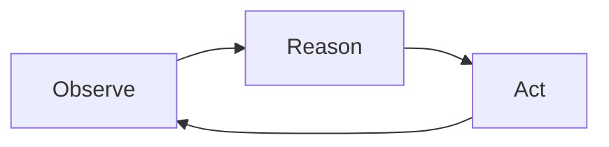

# Lab 1: The Naive Agent

**Duration:** ~20 minutes

???+ abstract "What You'll Build"
    In this lab you'll deploy a naive AI agent to **watsonx Orchestrate**. The agent reviews a patient's record and portal messages and lists concerns for the doctor. You'll look at the files that define the agent, see how we get valid JSON out of it, and run it against real (synthetic) patient data.

    In each step you run something and look at the result. By the end you'll have a working agent, a sense of what it does well, and a list of problems you'd want to fix before putting this anywhere near a real clinic.

---

## The Problem

Since the introduction of Electronic Health Record (EHR) portals, doctors are overwhelmed with messages from their patients. A single message might contain several unrelated questions. Some are urgent; most are routine. Responding to all of them comes on top of a full patient load — and that means keeping up is exhausting.

When patients don't get responses, important medical needs can go unaddressed.

???+ example "A real inbox backlog"
    Dr. Sarah Kim works at **Lakeview Family Medicine**. The 12 patients in the workshop dataset have **26 portal messages that still need a reply**. One is an urgent message from a patient whose pharmacy is refusing to fill their warfarin prescription. A later message from the same patient complains that nobody has replied.

    How should Dr. Kim prioritize? Which messages need attention today, and which can wait? What patient history is relevant to each message?

### The Question

Can we use an AI agent to support doctor-patient communication outside of appointments in a way that:

- **Preserves the doctor-patient relationship** — the doctor stays in the loop
- **Keeps the doctor as the expert** — the agent surfaces information, it doesn't make medical decisions
- **Reduces cognitive load** — the agent organizes and prioritizes, so the doctor can focus on the medicine

???+ warning "What we are NOT building"
    We are *not* building an agent that drafts responses for the doctor, makes diagnoses, or acts autonomously on patient care. That would be the Gmail "draft it for you" anti-pattern — tempting, but dangerous in a domain where the human must remain the expert.

    Instead, we want the agent to **surface and organize** information so the doctor can act on it efficiently. Think "intelligent inbox triage," not "AI doctor."

---

## The Agent Loop: Observe, Reason, Act

Before you deploy anything, here's the loop every agent in this workshop runs.

Most agents today use a version of **ReAct** (Yao et al., 2023). It's a loop with three steps:



| Step | What happens | In our case |
|---|---|---|
| **Observe** | The agent takes in new information — a query, updated data, tool results | A new patient message arrives, or the agent reads a patient record |
| **Reason** | The LLM decides what to do next — call a tool, ask for more info, or respond | "This message mentions warfarin — I should look up the patient's medication list and recent labs" |
| **Act** | The agent executes — calls a tool, writes to memory, or produces output | Calls `get_patient_record()`, reads the result, then summarizes findings |

The loop repeats until the agent decides it has enough information to produce a final response. On watsonx Orchestrate, you don't write this loop. Orchestrate runs it for any agent with `style: react_core`.

### Chat agents vs. background agents

Most people encounter agents as **chat agents** — you type a message, the agent reasons and responds, you type another message. The user drives each turn.

But there's another pattern that's often a better fit for real systems: the **background agent**.

| | Chat agent | Background agent |
|---|---|---|
| **Trigger** | User sends a message | New data arrives (a patient message, a database update) |
| **Session** | User-driven, multi-turn | Data-driven, often single-turn |
| **Ending** | User stops chatting | Agent decides it's done |
| **UI** | Chat window | Dashboard, inbox, notifications |

For our doctor inbox problem, a background agent is the better design: incoming patient messages trigger the agent, it processes them and updates a structured inbox, and the doctor interacts with the *inbox UI* — not with a chat window.

???+ tip "Why not chat?"
    A chat interface is risky here because you can't stop doctors from asking the agent to draft responses, make diagnoses, or confirm medical correctness. An inbox UI keeps the agent's role constrained to organizing information, preserving the doctor's role as the expert.

    Orchestrate gives every agent a chat preview. Anyone with access to your Orchestrate instance can chat with your agent there. The inbox UI only controls what doctors see. We come back to who can reach the agent in Lab 4.

---

## The Data

The workshop includes a set of synthetic EHR patient records. These simulate **Lakeview Family Medicine**, a small GP practice with three providers and 12 patients. The source files are `data/patients/patient_001.json` through `patient_012.json`.

During the workshop, a shared EHR server in the cloud serves these records. You have your own private copy of the 12 patients (see [Prerequisites](./prerequisites.md)).

Each patient record contains:

| Section | Contents |
|---|---|
| `demographics` | Name, DOB, contact info, insurance, preferred language |
| `socialHistory` | Smoking, alcohol, exercise, lifestyle notes |
| `familyHistory` | Family medical conditions |
| `allergies` | Known allergies with reactions and criticality |
| `conditions` | Active/resolved conditions with ICD-10 codes |
| `medications` | Current medications with RxNorm codes, dosages, prescribers |
| `immunizations` | Vaccination records with CVX codes |
| `encounters` | Office visit notes in SOAP format |
| `labs` | Lab results with LOINC codes, values, reference ranges |
| `messages` | Patient portal messages with threading and priority |

???+ info "How this data was generated"
    The synthetic data was generated using a structured pipeline designed to avoid common LLM pitfalls — see `data/README.md` for the full methodology. Key points:

    - A **diversity matrix** (`data/patient_specs.json`) was defined *before* generation to ensure varied demographics, conditions, communication styles, and clinical archetypes
    - Demographics were deliberately **decoupled from clinical attributes** — names and implied ethnicity do not predict occupation, condition, or communication style
    - Each patient was generated by an **isolated subagent** to prevent cross-patient pattern reuse
    - All medical codes (ICD-10, LOINC, RxNorm, CVX) are real

---

## Learning Objectives

By the end of this lab, you will:

- [x] Understand the ReAct loop (Observe → Reason → Act) and where it runs on watsonx Orchestrate
- [x] Know which files define an Orchestrate agent and what each one does
- [x] Know the difference between an agent that *surfaces information* and one that *generates content* — and why it matters in healthcare
- [x] Know two ways to get structured output from an LLM: constrained decoding, and prompting with a schema plus validation and retry
- [x] Deploy the agent, run it against synthetic patient data, and find its runs in Orchestrate
- [x] Identify the limitations of a naive implementation

---

## Anatomy of an Orchestrate Agent

The Lab 1 agent is in `lab1/agent/`. Five files there define the agent, deploy it, and call it. The diagram shows where each piece runs.

<div class="wxo-anatomy" style="margin:1.5em 0">
<svg class="wxo-anatomy-svg" viewBox="0 0 760 756" xmlns="http://www.w3.org/2000/svg" role="img" aria-label="Your machine holds agent.yaml, tools.py and connection.yaml. deploy.py reads all three and imports them into watsonx Orchestrate with the orchestrate CLI. agent.py calls your agent through the runs API. In Orchestrate, the agent runs a ReAct loop with an LLM and calls tools in the tool runtime, which reads the EHR connection and fetches records from the shared EHR in the cloud. The agent and the tools are recorded in traces." style="width:100%;max-width:760px;height:auto;display:block;margin:0 auto">
<style>
.wxo-anatomy-svg { font-family: 'IBM Plex Sans', sans-serif; color: inherit; }
.wxo-anatomy-svg text { fill: currentColor; font-size: 16px; }
.wxo-anatomy-svg text.t { font-size: 18px; font-weight: 600; }
.wxo-anatomy-svg text.mono { font-family: 'IBM Plex Mono', monospace; font-size: 18px; font-weight: 600; }
.wxo-anatomy-svg text.zone { fill: #8d8d8d; font-size: 16px; font-weight: 600; letter-spacing: 0.04em; }
.wxo-anatomy-svg text.lbl { fill: #8d8d8d; font-size: 16px; }
.wxo-anatomy-svg text.on-blue { fill: #ffffff; }
.wxo-anatomy-svg .box { fill: none; stroke: currentColor; stroke-width: 1.5px; }
.wxo-anatomy-svg .box.blue { fill: #0f62fe; stroke: none; }
.wxo-anatomy-svg .box.soft { fill: rgba(141,141,141,0.16); stroke: none; }
.wxo-anatomy-svg .zone-r { fill: none; stroke: #8d8d8d; stroke-width: 1.5px; stroke-dasharray: 6 6; }
.wxo-anatomy-svg .edge { fill: none; stroke: currentColor; stroke-width: 2px; marker-end: url(#wxo-arrow); }
.wxo-anatomy-svg .edge.rec { stroke: #8d8d8d; stroke-dasharray: 6 5; marker-end: url(#wxo-arrow-muted); }
</style>
<defs>
<marker id="wxo-arrow" viewBox="0 0 10 10" refX="10" refY="5" markerWidth="7" markerHeight="7" markerUnits="strokeWidth" orient="auto"><path d="M0 0 L10 5 L0 10 z" fill="currentColor"/></marker>
<marker id="wxo-arrow-muted" viewBox="0 0 10 10" refX="10" refY="5" markerWidth="7" markerHeight="7" markerUnits="strokeWidth" orient="auto"><path d="M0 0 L10 5 L0 10 z" fill="#8d8d8d"/></marker>
</defs>
<!-- Zone A: your machine (y 1-290) -->
<rect class="zone-r" x="1" y="1" width="758" height="289"/>
<text class="zone" x="24" y="28">YOUR MACHINE · lab1/agent/</text>
<rect class="box soft" x="12" y="40" width="736" height="108"/>
<rect class="box" x="24" y="52" width="228" height="84"/>
<text class="mono" x="40" y="80">agent.yaml</text>
<text x="40" y="104">instructions, model,</text>
<text x="40" y="124">list of tools</text>
<rect class="box" x="266" y="52" width="228" height="84"/>
<text class="mono" x="282" y="80">tools.py</text>
<text x="282" y="104">Python @tool functions,</text>
<text x="282" y="124">uploaded as-is</text>
<rect class="box" x="508" y="52" width="228" height="84"/>
<text class="mono" x="524" y="80">connection.yaml</text>
<text x="524" y="104">EHR URL and</text>
<text x="524" y="124">your tenant ID</text>
<line class="edge" x1="197" y1="148" x2="197" y2="176"/>
<text class="lbl" x="210" y="168">reads all three</text>
<rect class="box blue" x="24" y="176" width="346" height="96"/>
<text class="mono on-blue" x="44" y="204">deploy.py</text>
<text class="on-blue" x="44" y="230">adds your prefix to each name,</text>
<text class="on-blue" x="44" y="254">imports connection, tools, agent</text>
<rect class="box" x="390" y="176" width="346" height="96"/>
<text class="mono" x="410" y="204">agent.py</text>
<text x="410" y="230">asks the agent to review a patient,</text>
<text x="410" y="254">validates the JSON, retries once</text>
<!-- arrows from your machine into Orchestrate -->
<line class="edge" x1="197" y1="272" x2="197" y2="340"/>
<text class="lbl" x="210" y="318">imports with the orchestrate CLI</text>
<line class="edge" x1="563" y1="272" x2="563" y2="388"/>
<text class="lbl" x="576" y="318">runs API</text>
<!-- Zone B: watsonx Orchestrate (y 340-604) -->
<rect class="zone-r" x="1" y="340" width="758" height="264"/>
<text class="zone" x="24" y="368">WATSONX ORCHESTRATE (HOSTED)</text>
<rect class="box soft" x="24" y="388" width="326" height="196"/>
<text class="t" x="44" y="418">Traces</text>
<text x="44" y="446">one per run, with each</text>
<text x="44" y="470">LLM call and tool call</text>
<text class="lbl" x="44" y="556">you look at these in Step 4</text>
<rect class="box blue" x="410" y="388" width="326" height="72"/>
<text class="t on-blue" x="430" y="416">Your agent</text>
<text class="on-blue" x="430" y="442">ReAct loop, Claude Sonnet 5.5</text>
<line class="edge" x1="500" y1="460" x2="500" y2="500"/>
<text class="lbl" x="512" y="486">calls tools</text>
<rect class="box" x="410" y="500" width="174" height="84"/>
<text class="t" x="426" y="530">Tool runtime</text>
<text x="426" y="556">runs your tools.py</text>
<line class="edge" x1="584" y1="542" x2="612" y2="542"/>
<rect class="box" x="612" y="500" width="124" height="84"/>
<text class="t" x="626" y="530">Connection</text>
<text x="626" y="552">EHR URL +</text>
<text x="626" y="572">your tenant</text>
<line class="edge rec" x1="410" y1="424" x2="350" y2="424"/>
<line class="edge rec" x1="410" y1="542" x2="350" y2="542"/>
<!-- Zone C: shared EHR (y 630-754) -->
<line class="edge" x1="500" y1="584" x2="500" y2="674"/>
<text class="lbl" x="512" y="623">gets patient records</text>
<rect class="zone-r" x="390" y="636" width="369" height="118"/>
<text class="zone" x="736" y="662" text-anchor="end">SHARED EHR (CLOUD)</text>
<rect class="box" x="410" y="674" width="326" height="64"/>
<text class="t" x="430" y="700">Lakeview EHR</text>
<text x="430" y="724">your copy of the 12 patients</text>
</svg>
</div>

Your agent and its tools run on Orchestrate, not on your laptop. Your laptop has the agent's definition files and `agent.py`, which asks the agent to review a patient. That's why you deploy before you run it, and why you look at Orchestrate's traces to see what the agent did.

### `agent.yaml`: the agent definition

This file defines the agent: its name, the model, the system prompt (`instructions`), and the tools it can call.

```yaml
spec_version: v1
kind: native
name: lakeview_inbox_agent
style: react_core              # Orchestrate runs the ReAct loop
llm: virtual-model/anthropic/claude-sonnet-5-5
instructions: |
  You are a clinical inbox assistant for a primary care practice. ...
  - Only surface information that is IN the record. Do not infer diagnoses.
  - Do not draft replies or make clinical recommendations.
tools:
- list_patients
- get_patient_record
- get_messages
- search_labs
- get_inbox
```

Read the full `instructions` in the file. You'll compare them with the agent's output in Step 5.

### `tools.py`: what the agent can do

Each function decorated with `@tool` from the Orchestrate ADK becomes a tool the LLM can call. The ADK builds the tool's schema from the type hints. The docstring becomes the tool description the LLM sees.

```python
@tool(expected_credentials=EHR_CREDENTIALS)
def get_patient_record(patient_id: str) -> dict:
    """Get a patient's full record: demographics, conditions, allergies, medications,
    lab results, encounter history, messages, and social history."""
    resp = _get(f"/patients/{patient_id}")
    resp.raise_for_status()
    return resp.json()
```

`deploy.py` uploads this file to Orchestrate as-is, and the tools run there. The file can't import anything else from the repo. `_get` reads the EHR URL and your tenant ID from the Orchestrate connection:

```python
def _get(path: str):
    conn = connections.key_value(EHR_APP_ID)
    return requests.get(f"{conn['base_url'].rstrip('/')}{path}",
                        headers={"X-Tenant": conn.get("tenant", "")}, timeout=30)
```

The agent has five tools: `list_patients`, `get_patient_record`, `get_messages`, `search_labs`, and `get_inbox`.

???+ question "Think about this"
    Notice that the agent can call `list_patients()` or `get_patient_record()` for *any* patient — not just the one it was asked to review. What could go wrong?

### `connection.yaml`: where the data is

This file defines a key-value connection named `lakeview_ehr`. `deploy.py` imports it and sets two values from your `.env`: `base_url`, the address of the shared EHR, and `tenant`, the ID of your copy of the patients. Your tools read both values when they run.

### `deploy.py`: getting it all into Orchestrate

Everyone in the workshop shares one Orchestrate instance, and agent, tool, and connection names must be unique in an instance. `deploy.py` adds your prefix (`WXO_NAME_PREFIX` in `.env`, for example `student0_`) to each name. Then it runs three `orchestrate` CLI imports:

```python
orchestrate("connections", "import", "-f", str(tmp / "connection.yaml"))
orchestrate("tools", "import", "-k", "python", "-f", str(tmp / "tools.py"),
            "-r", str(REQUIREMENTS), "-a", app_id)
orchestrate("agents", "import", "-f", str(tmp / "agent.yaml"))
```

Your deployed agent is named `<prefix>lakeview_inbox_agent`. Before the import, `deploy.py` also adds the output format to the instructions. See [Structured Outputs](#structured-outputs).

### `agent.py`: asking the agent for a review

`agent.py` sends one message to your agent through Orchestrate's runs API. It waits for the run to finish, then checks the reply:

```python
user_message = (
    f"Please review patient {patient_id}. "
    "Start by looking at their messages and record, then investigate "
    "any concerns you find. When done, output your findings."
)
text, thread_id = _client.run(user_message)
```

This is the only message it sends. The agent decides which tools to call.

### The output contract: `models.py`

The agent's reply must be a `PatientConcerns` object (in `lab1/agent/models.py`), which holds a list of `Concern`s. `Concern` is defined in `app/models.py`, the same model the inbox UI uses:

```python
class Concern(BaseModel):
    id: str
    patient_id: str
    title: str
    summary: str               # one sentence
    action: str = ""           # what the doctor should do
    concern_type: ConcernType  # medication, lab_result, symptom, follow_up, administrative
    urgency: Urgency           # routine, soon, urgent
    status: ConcernStatus      # unresolved, monitoring, resolved
    onset: str
    last_updated: str
    evidence: list[str]        # specific values and dates
    related: RelatedData = RelatedData()  # links back to messages, labs, conditions, encounters
```

This is the **contract** between the agent and the UI. The agent fills it in; the UI renders it. The inbox never shows the doctor raw LLM output.

---

## Structured Outputs

No one reads the background agent's replies before they're saved. If a reply isn't valid JSON for `PatientConcerns`, the UI has nothing to show. There are two ways to get valid JSON from an LLM.

Some inference services offer *constrained decoding*, which works like this: you send a JSON Schema with the request. At each step of generation, the server masks every token that would break the schema, so the model can only pick tokens that keep the JSON valid. The output always parses.

Without that, we recommend *prompt with the schema, validate, and retry*. Lab 1 does it in three parts:

1. **Prompt with the schema.** `deploy.py` generates the JSON Schema from the Pydantic models in `models.py` and adds it to the end of the agent's instructions. When you change `models.py`, the next deploy updates the prompt.

    ```python
    spec["instructions"] += (
        "\nFINAL ANSWER FORMAT:\n"
        "When you have finished investigating, reply with ONLY a JSON object (no prose, "
        "no markdown, no code fences) that validates against this JSON Schema:\n"
        + json.dumps(output_schema(), separators=(",", ":"))
        + "\n"
    )
    ```

2. **Validate.** `agent.py` parses the reply with Pydantic. If the reply doesn't match the schema, Pydantic raises a `ValidationError` that lists each problem.
3. **Retry once.** If validation fails, `agent.py` sends the error to the agent in the same conversation and asks for corrected JSON. If the second reply also fails, the run fails with an error and nothing is saved.

    ```python
    except ValidationError as e:
        if attempt == MAX_FORMAT_RETRIES:
            raise
        text, thread_id = _client.run(
            "Your reply was not valid JSON for the required schema. Error:\n"
            f"{e}\n"
            "Reply again with ONLY the corrected JSON object.",
            thread_id=thread_id,
        )
    ```

Orchestrate's `react_core` agents don't offer constrained decoding, so Lab 1 uses prompt, validate, and retry. Here's a quick test you can run against our backend after you deploy your agent in Step 2:

```bash
cd ~/ai-agents-workshop
uv run python scripts/check_structured_outputs.py --patients 3 --skip-judges
```

The script sends your agent the same message `agent.py` sends, for `patient-001` through `patient-003`. It validates each reply and retries once, the same way `agent.py` does. It prints one line per patient:

- `ok`: the first reply was valid `PatientConcerns` JSON
- `ok (retry)`: the first reply failed validation, and the retry fixed it
- `FAIL`: still invalid after the retry, with the validation error

The summary table counts **1st-try valid** and **valid after retry**. Each line also shows how many tool calls the agent made. You'll need that number in [What's Broken](#whats-broken).

When we ran this on all 12 patients with Claude Sonnet 5.5, 10 first replies were valid and one retry fixed the other 2. Your numbers may differ.

<!-- TODO(verify): source for this claim; the link couldn't be checked during the content review. Restore once confirmed.
Structured-decision models such as [Jev](https://opentweet.io/jev/vs-openai-structured-outputs) have recently made a business of this, so constrained outputs may come back into the mainstream soon.
-->

---

## Step 1: Explore the EHR Inbox

Before you deploy anything, look around the application. If the inbox from [Prerequisites](./prerequisites.md) is still running, skip this command and switch to its browser tab.

```bash
cd ~/ai-agents-workshop
uv run streamlit run app/ui.py --server.port 8501
```

Open [http://localhost:8501](http://localhost:8501) in your browser.

This is Dr. Kim's inbox dashboard. Take a minute to explore:

- **Patient selector** (top) — switch between patients. The emoji shows inbox status.
- **Medical record** (left) — conditions, medications, labs, encounter history. Click the tabs.
- **Concerns panel** (right) — empty for now. This is where the agent's output will appear.
- **Inbox** (bottom left) — patient portal messages, newest first. Click one to see the full conversation.

???+ question "Look at the inbox"
    Browse a few patients and their messages. Notice how some messages touch on multiple topics — a patient might ask about a medication refill *and* report a new symptom in the same message.

    Now imagine you're Dr. Kim with a full day of appointments. How would you decide which messages need attention first?

---

## Step 2: Deploy Your Agent

Leave the inbox running. Open a second terminal and deploy the agent to Orchestrate:

```bash
cd ~/ai-agents-workshop
uv run python -m lab1.agent.deploy
```

The script prints each `orchestrate` command as it runs. It imports the connection and sets its values, then imports the tools, then the agent. The last line is:

```
Deployed. New tools can take a few minutes before the agent can call them.
```

???+ warning "The first few minutes after a deploy"
    Orchestrate sets up new tools in the background. For the first few minutes after a deploy, a tool call may return a message that the tool is still being configured. The agent's answer then won't make sense. Wait a couple of minutes and run the agent again.

    This happens every time you run `deploy.py`.

???+ question "Ask Bob"
    While the tools warm up, open `lab1/agent/deploy.py` in Bob and ask:

    - "What does deploy.py change in agent.yaml and tools.py before it calls the orchestrate CLI?"
    - "Where does the tenant ID that tools.py sends to the EHR come from?"

---

## Step 3: Run the Agent

In the second terminal, start the Lab 1 agent service:

```bash
cd ~/ai-agents-workshop
uv run uvicorn lab1.agent.api:app --port 8001
```

The inbox UI calls this service. When you click **Run Agent**, the service calls `agent.py`. `agent.py` starts a run of your agent on Orchestrate, validates the reply, and saves the concerns.

Now go back to the UI at [http://localhost:8501](http://localhost:8501):

1. Select a patient from the dropdown
2. Click **Run Agent** in the Concerns panel
3. Wait for the agent to finish (the button will show "Agent Running..."). A run takes about 40 seconds, sometimes longer.
4. Examine the concerns that appear

???+ tip "Try several patients"
    Run the agent on 2-3 different patients. Notice how:

    - Concerns are sorted by urgency (🔴 urgent → 🟡 soon → 🔵 routine)
    - Each concern has a specific **action** for the doctor
    - The **Related** links let you jump to the relevant message, lab, or encounter
    - The patient dropdown updates with urgency indicators

    Write down which patients you ran and how many concerns each one got. You'll look at those runs in Step 4.

---

## Step 4: See It in Orchestrate

Orchestrate records a trace for each run of your agent. You didn't write any code for this. A trace shows every LLM call and tool call in the run.

1. Open the watsonx Orchestrate UI for the workshop instance (the same instance the setup script found for you).
2. From the main menu, open **Analyze**. You'll see a table of agents, including the other students' agents, because everyone shares the instance.
3. Click your agent. Its name starts with your prefix, for example `student0_lakeview_inbox_agent`.
4. Pick one of your runs from the list and open its details.

<!-- TODO(verify): exact menu labels in the workshop tenant's UI (see the matching TODO in lab-2.md). IBM's "Monitoring agents" page documents Analyze > Agent analytics > Traces > Trace details. -->

For each run, look for:

- **Which tools it called**, in what order, with what arguments
- **The LLM calls** between tool calls, and the final reply (the raw JSON before `agent.py` validated it)
- **How long** each step took

Compare the run with the most concerns and the run with the fewest. How many tool calls did the agent make in each before it answered?

???+ info "More in Lab 2"
    For now, just find your runs. Lab 2 covers traces in detail.

---

## Step 5: Evaluate the Output

Read the concerns for each patient you ran, next to the patient's record in the inbox UI.

???+ question "Write down 2-3 things"
    For each patient you review, write down:

    1. **Something the agent got right** — a concern that's genuinely useful, well-evidenced, and actionable
    2. **Something the agent got wrong** — a concern that's misleading, vague, or incorrect
    3. **Something that's missing** — a real issue in the patient's record that the agent didn't surface

    Keep these notes. We'll use them throughout the remaining labs.

??? example "Extra credit"
    - Run the same patient twice. Do the concerns change? (The `scripts/check_structured_outputs.py` command above accepts `--rounds 2`.)
    - Open `agent.yaml` and read the output rules in `instructions`. Find a concern that breaks one of them.
    - Change the instructions to fix a problem you wrote down. For example, tell the agent to call `search_labs` for any lab value it cites. Redeploy with `uv run python -m lab1.agent.deploy`, wait a couple of minutes, and run the same patient again. Did the concerns or the tool calls change?
    - Ask Bob: "Read lab1/agent/agent.yaml. Which of its output rules could a program check automatically, and which need a person or another model?"

---

## What's Working

Some of this naive agent already works well:

**Orchestrate runs the ReAct loop.** The agent is a YAML file and five Python functions. Orchestrate calls the LLM, runs your tools, and records each step. The agent decides which tools to call.

**Every reply is validated.** The JSON Schema in the prompt comes from the same Pydantic model the UI uses. `agent.py` validates each reply and retries once with the error. Only valid `PatientConcerns` reach the inbox.

**The UI keeps the doctor in control.** The doctor clicks a button, reviews structured output, and acts on it. There's no chat box where they might ask the agent to draft a reply or confirm a diagnosis.

**The agent runs in the background.** It writes its concerns to a store, and the doctor sees them when they're ready. The doctor doesn't sit in a conversation waiting for each answer.

---

## What's Broken

But this agent has serious problems. Some you probably noticed in your evaluation:

### 🔍 Nothing checks how much it looked at

The instructions say "Gather evidence before concluding." Whether the agent does depends on the model. `get_patient_record` returns the whole record in one call, so an agent can answer after one tool call without searching for lab trends or reading the rest of a thread. The first model we tried, gpt-oss-120b, often did exactly that and returned no concerns for some patients. Claude Sonnet 5.5 found concerns for all 12 patients in our tests, but nothing in the loop would tell you if it skipped something.

Check the tool calls in your traces. Lab 3 adds automatic checks.

### 🔓 No access controls

The agent can access any patient's data at any time. When you ask it to review `patient-001`, nothing stops it from calling `get_patient_record("patient-007")`. In a real system, this would violate HIPAA's minimum necessary standard — the agent should only see data relevant to its current task.

### 🎲 Concerns aren't stable

Run the agent twice on the same patient. You'll likely get different concerns: different titles, different urgency levels, maybe different issues. Each run overwrites the patient's previous concerns. There's no history and no way to see how concerns changed between runs.

### 🤥 No hallucination checks

The agent might report a lab value that doesn't exist, misattribute a symptom, or fabricate evidence. Validation checks only that the JSON matches the schema. Nothing checks the values against the patient record. We're trusting the LLM to be accurate — and it won't always be.

### 👨‍⚕️ The agent may overstep

Read the instructions in `agent.yaml` carefully. They tell the agent not to infer diagnoses or make clinical recommendations. Check whether your agent's concerns:

- Suggest diagnoses ("possible hypothyroidism")
- Recommend treatments ("consider starting levothyroxine")
- Editorialize on urgency in ways that could bias the doctor

Models are trained to be helpful, so they often add a likely diagnosis or a next step. In this inbox, that steers the doctor before they've read the record.

### 📋 No completeness checks

How do you know the agent found *all* the concerns? It might surface 3 out of 5 real issues and you'd never know. There's no mechanism to verify coverage — no comparison against the actual record, no checklist, no second opinion.

---

## Up Next

Any one of these problems would stop a real practice from deploying this agent. The remaining labs work on them:

| Lab | Problem | Approach |
|---|---|---|
| ~~[Lab 1](lab-1.md)~~ | ~~No structure, no tools, just vibes~~ | ~~A ReAct agent on Orchestrate with validated structured output~~ |
| **[Lab 2](lab-2.md)** | No visibility into what the agent is doing | Observability: Orchestrate traces, a PII control and a plug-in |
| **[Lab 3](lab-3.md)** | Shallow investigation, unstable output, hallucinations, overstepping | Evaluation: claim extraction, grounding checks, LLM-as-judge, critic |
| **[Lab 4](lab-4.md)** | Unrestricted data access | Security: who and what can reach patient data |

???+ tip "Keep your notes"
    The issues you wrote down in Step 5 are your personal roadmap for the next three labs. As we add observability, evaluation, and security, check whether each improvement addresses something you noticed.

!!! note "Want to run it all on your laptop?"
    The [open-source edition of this workshop](https://obuzek.github.io/ai-agents-workshop/oss/lab-1/) builds the same agent with LangGraph. Everything in it runs on your laptop.
