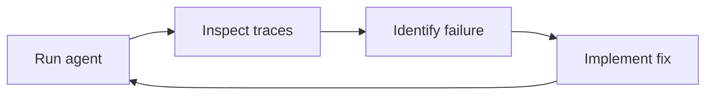
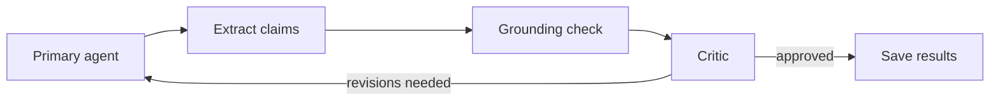

# Lab 3: Improving Your Agent

**Duration:** ~25 minutes

???+ abstract "What You'll Do"
    In Lab 2 you read your agent's traces and compared the tool output with the concerns. Some concerns may cite evidence you can't find in the tool output. Some may suggest a diagnosis.

    This lab covers how to check an agent's work: grounding checks, LLM-as-judge, a critic, and tools that return less. You'll read about each one, then run three **judge agents** on Orchestrate against your agent's concerns and read their verdicts in the traces.

---

## Where We Are in the ADLC

Lab 1 built the agent. Lab 2 made it observable. Lab 3 uses what you observed to improve what you built:



This is the inner loop of the ADLC's Operations & Governance phase: monitor, find a problem, fix it, redeploy. Lab 2 gave you the **inspect** step. Lab 3 is about the **check** that comes before a fix: an automatic way to find the failures you were spotting by eye.

---

## Learning Objectives

By the end of this lab, you will:

- [x] Name the failures an agent check has to catch: made-up evidence, going off-task, shallow investigation
- [x] Explain claim extraction, grounding checks and LLM-as-judge
- [x] Explain how a critic and a revision loop use those checks
- [x] Run three judge agents on your agent's output and read their verdicts in Orchestrate
- [x] Name the limits of this check: what it's grounded against, and the same model judging itself

---

## What Lab 2 Showed

Look back at your Lab 2 traces. Three kinds of problem show up.

### The agent can make up evidence

Compare the tool output with the agent's concerns. An evidence string may cite a lab value, a date or a medication that isn't in what the tools returned. The agent states it with the same confidence as everything else.

### The agent can go off-task

The instructions say "do not make clinical recommendations." The agent may still suggest a diagnosis, propose a treatment, or draft a reply. Its job is to organize what the doctor needs to see.

### The agent may not look far

`get_patient_record` returns the whole record in one block. One call gives the agent everything, so it has little reason to search for a lab trend or read a whole thread, and every run puts the whole record in the model's context and in the trace. How often an agent answers after one call depends on the model: gpt-oss-120b often did, and missed concerns. Check the tool-call counts in your own traces.

---

## How to Check an Agent's Work

### Claim extraction

A concern mixes specific facts ("TSH 4.8 mIU/L on 2026-04-01") with vague descriptions ("recent lab results"). A vague description passes any check, because it doesn't assert anything you can look up.

So the first step pulls out every specific claim. A model reads the concern's summary, action and evidence, and returns a list of self-contained claims: "Patient's HbA1c is 8.2%", "TSH trending up from 3.1 to 4.8 over 6 months". Internal IDs are replaced with what they refer to. Vague references are dropped.

The prompt is `_EXTRACT_PROMPT` in `lab3/agent/grounding.py`.

### Grounding

A **grounding check** takes each claim and the source data, and decides whether the source data supports the claim. The answer per claim is `supported: true` or `false`, with a reason.

The source data should be what the agent actually saw: the tool output from its run. A claim that's true in the full record but wasn't in anything the tools returned means the agent guessed.

### LLM-as-judge

The simplest grounding check is another LLM call: give a model the source data and the claims, and ask it to judge. This is **LLM-as-judge**. The prompt is `_JUDGE_PROMPT` in `lab3/agent/grounding.py`.

Its weakness is **self-evaluation bias**. If the judge is the same model as the agent, it has the same blind spots.

A purpose-built judge avoids this. IBM's [Granite Guardian](https://www.ibm.com/granite/docs/models/guardian/) is a separate model trained to detect risks, including groundedness: given a context and a claim, it answers whether the claim is supported. IBM documents Granite Guardian on watsonx.ai. We haven't set it up for this workshop, so today's judges use the same model as the agent.

### Why one claim at a time

A grounding model that answers yes or no for a whole concern can't tell you which sentence is wrong. With one verdict per claim, you get "TSH 4.8 is supported, but 'patient reported dizziness' is not." That gives the next step something specific to act on.

### The critic and the revision loop

A **critic** reads the concerns and the grounding verdicts and decides, per concern: is it on task, is it grounded, does it need revision? It returns feedback and an overall `approved`. The prompt is `_CRITIC_PROMPT` in `lab3/agent/critic.py`.

In a full loop, the feedback goes back to the agent, which revises its concerns, and the checks run again, up to a set number of rounds:



We haven't built this loop on Orchestrate for this edition, so today you run the three checks on their own. There are two ways you could close it on Orchestrate:

- **From your code.** Your code calls the critic agent, then sends its feedback to the inbox agent on the same thread. Lab 1's `agent.py` already continues a thread this way when it retries a bad reply.
- **As collaborator agents.** The inbox agent calls the critic itself. IBM documents collaborator agents for Orchestrate; we haven't tested them here.

The repository's `lab3/agent/` has the full loop for the open-source edition, written in LangGraph. Read it if you want to see one working version.

### Focused tools

Checks catch problems after the agent answers. Tool design prevents some of them.

If `get_patient_record` returns everything, the agent doesn't have to decide what's relevant. Compare tools that search for one thing:

```python
@tool
def search_conditions(patient_id: str, keyword: str) -> list[dict]:
    """Search a patient's conditions by keyword (e.g., 'diabetes', 'hypertension')."""
```

The agent has to say what it's looking for: "the patient mentioned fatigue, so search for thyroid conditions and TSH labs." Each call returns less data, so there's less in the model's context to misread and less patient data in the trace. This is the same "minimize at the source" layer from Lab 2.

If you split the record into `get_conditions`, `get_medications` and `get_labs` with no keyword, the agent would likely call all of them and rebuild the full record. The keyword is what forces it to choose.

`lab3/agent/tools.py` has keyword search tools (`search_conditions`, `search_medications`, `search_encounters`) from the open-source edition. Your Lab 1 agent already has one: `search_labs`.

### Prompt injection

Patient portal messages are untrusted text, and they reach the agent through tool output. A message could include instructions aimed at the agent.

In this system the agent's output goes to the doctor. The patient never sees it, so an attacker gets no feedback on what worked. That limits the risk but doesn't remove it: injected text could still change which concerns the doctor sees. In Lab 2's tests, no control ran on tool output. The checks in this lab help here too: a concern that isn't grounded in the record gets flagged whatever caused it.

---

## Run the Judge Agents

Your Lab 1 agent should still be deployed. Run:

```bash
cd ~/ai-agents-workshop
uv run python scripts/check_structured_outputs.py --patients 3
```

This takes a few minutes. The script:

1. Runs your agent, `<prefix>lakeview_inbox_agent`, on `patient-001` to `patient-003`, the same way the inbox UI does.
2. Creates (or updates) three small agents on Orchestrate, with no tools, under your prefix: `<prefix>claim_extractor`, `<prefix>grounding_judge` and `<prefix>critic`. Their instructions are the Lab 3 prompts above, plus the JSON format each one must reply in.
3. For each patient, takes up to three of your agent's concerns and sends each one to the claim extractor, then sends the claims to the grounding judge.
4. Sends all of the patient's concerns and the verdicts to the critic.

All four agents use the same model, Claude Sonnet 5.5.

???+ question "Ask Bob"
    While it runs, open `scripts/check_structured_outputs.py` and ask Bob: "What does deploy_judges send to Orchestrate, and where do the judges' instructions come from?"

### What you'll see in the terminal

One line per step. Yours will have different titles, timings and counts:

```
Main agent: student0_lakeview_inbox_agent (3 patients x 1 round(s))
  patient-001 r1: ok 21s, 1 tool calls, 4 concerns
  ...
Deployed judge agents: student0_claim_extractor, student0_grounding_judge, student0_critic

Grounding + critic on 3 patients (up to 3 concerns each)
  extraction patient-001 Rising TSH with new tachy: ok 6s
  judge      patient-001 Rising TSH with new tachy: ok 9s
  ...
  critic     patient-001: ok 12s
```

`ok` means the reply was valid JSON for that step's schema. `ok (retry)` means the first reply wasn't and one retry fixed it. `FAIL` means it was still invalid. The summary table at the end counts these per step.

The terminal shows whether each judge **answered in the right format**. It doesn't print what they decided. For that, open the traces.

### What you'll see in Orchestrate

In **Analyze**, open each judge agent and look at its most recent traces, the same way you did in Lab 2.

- **`<prefix>claim_extractor`**: the input is one concern. The output is a list of claims. Did it drop anything specific? Did it keep anything vague?
- **`<prefix>grounding_judge`**: the input is the patient's record and the claims. The output is one verdict per claim, `supported` with a `reason`. Look for `supported: false`. Then check the record yourself: is the judge right?
- **`<prefix>critic`**: the output has, per concern, `on_task`, `grounded`, `revision_needed` and `feedback`, plus an overall `approved` and `summary`. Did the critic flag the concerns you'd flag? Did it flag anything for suggesting a diagnosis?

???+ warning "Two limits of this check"
    **It's grounded against the full record.** The script sends the judge the patient's whole EHR record (cut to 60,000 characters), not the tool output from your agent's run. A claim can be supported by the record even though your agent never fetched that data. This check catches claims that aren't true. It doesn't catch claims the agent made without looking.

    **The same model judges itself.** The agent and all three judges run on Claude Sonnet 5.5. A mistake the model tends to make as the agent, it may also accept as the judge. A purpose-built judge such as Granite Guardian is one way around this. It isn't available in this edition.

???+ question "Things to notice"
    1. How many concerns had at least one `supported: false` claim? When you check them by hand, are they real mistakes?
    2. Did the critic approve every patient? If it did, read its feedback. Is it checking anything, or agreeing?
    3. Run it twice (`--rounds 2` re-runs your agent; the judges run on the first round). Do the verdicts change?

??? example "Extra credit"
    - Read `_JUDGE_PROMPT` and `_CRITIC_PROMPT` in `lab3/`. Find an instruction the judge or critic didn't follow in your traces.
    - Tighten the critic. Add a rule to `_CRITIC_PROMPT` in `lab3/agent/critic.py`, for example "Flag any concern whose action recommends a treatment." Keep the `CONCERNS:` line and everything below it. Run the script again: it redeploys the judge agents from the prompts each time. Did the critic's verdicts change?
    - In `scripts/check_structured_outputs.py`, find where the judge's source data is built (search for `SOURCE DATA`). What would you need from Lab 2's traces to ground against the tool output instead?
    - Write down how you'd wire the critic's feedback back into your agent. Your Lab 1 `agent.py` already continues a conversation by `thread_id` when it retries a bad reply.

---

## What's Working

**Each check is a small agent with one job.** The extractor, the judge and the critic each have one prompt and one output schema. You can read each one's input and output in its own trace.

**Verdicts are per claim.** When the judge rejects something, you know which fact it rejected and why.

**The checks use structured output.** Every verdict is validated against a schema, so a program can act on it: count failures, route a concern back for revision, or hold it from the inbox.

???+ info "Where Orchestrate evaluations and watsonx.governance fit"
    Today's judges are agents you deploy yourself, so you can read every prompt and verdict. IBM documents tools for the same job, which we haven't tested in this workshop:

    - The ADK's `orchestrate evaluations` commands run test cases against an agent and check which tools it called and in what order ([Evaluations](https://developer.watson-orchestrate.ibm.com/evaluate/overview.md)).
    - The watsonx.governance SDK, `ibm-watsonx-gov`, has metrics such as faithfulness, answer relevance and tool-call accuracy ([ibm-watsonx-gov](https://ibm.github.io/ibm-watsonx-gov/)).
    - watsonx.governance keeps a record of each AI use case and its evaluation results, which is what an auditor asks for.

---

## What's Still Broken

**The loop isn't closed.** The critic's feedback doesn't go back to your agent. Nothing gets revised.

**The check is weaker than it looks.** It grounds against the full record, and the same model judges its own kind of output.

**The agent still has unrestricted access.** Any tool can fetch any patient's record. There's no record of who asked for what, and no identity attached to the request. That's Lab 4.

---

## Up Next

| Lab | Problem | Solution |
|---|---|---|
| ~~[Lab 1](lab-1.md)~~ | ~~No structure, no tools, just vibes~~ | ~~A ReAct agent with structured output~~ |
| ~~[Lab 2](lab-2.md)~~ | ~~No visibility into agent behavior~~ | ~~Orchestrate traces, PII controls and plug-ins~~ |
| ~~[Lab 3](lab-3.md)~~ | ~~Hallucinations, overstepping, shallow investigation~~ | ~~Evaluation: grounding checks, LLM-as-judge, critic~~ |
| **[Lab 4](lab-4.md)** | Unrestricted data access | Security: where the data lives, who can read it, identity end to end |
