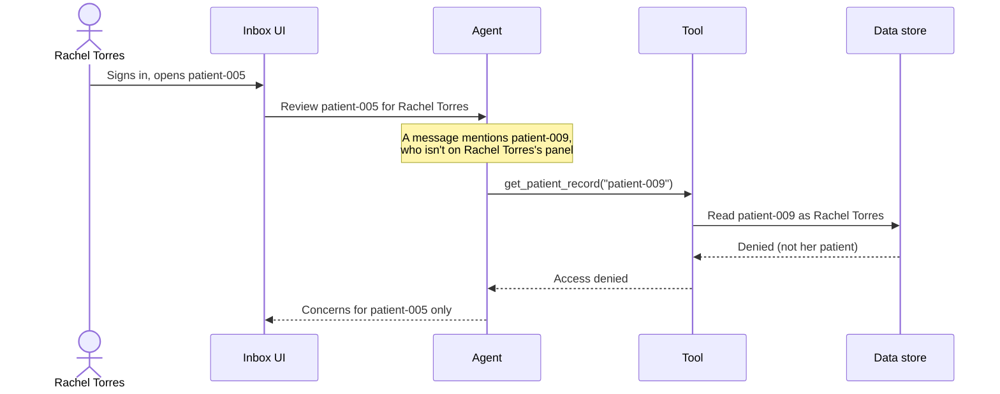

# Lab 4: Securing Data Used By The Agent

**Duration:** ~15 minutes

???+ abstract "What You'll Cover"
    Your agent reads patient records and writes concerns about them. Copies of that data now exist in several places: the EHR, the model's context, Orchestrate's traces, and the concerns file on your laptop.

    This lab is a discussion with one short look at a trace. You'll list where the agent's data lives, check what IBM documents about how watsonx Orchestrate stores it, and work through who should be able to read each copy. Then you'll look at why access rules belong in the data layer, and why the clinician's identity has to travel with every request.

---

## Where We Are in the ADLC

Lab 1 built the agent. Lab 2 made it observable. Lab 3 checked its work. Lab 4 is **Governance**: making sure every copy of the data the agent touches is protected as well as the original.

---

## Learning Objectives

By the end of this lab, you will:

- [x] List every place this agent's data is stored or processed, and who can read each one
- [x] Say what IBM documents about storage on watsonx Orchestrate (region, encryption, isolation, retention, compliance) and what it doesn't
- [x] Explain why an agent's output is PHI that needs the same protection as its input
- [x] Explain why access control belongs in the data layer, not in the prompt or the UI
- [x] Explain how keeping the clinician's identity attached end to end limits what the agent can fetch
- [x] Find, in a trace, where your agent's tools return data about every patient

---

## Agent Output Is Sensitive Data

A concern like "INR trending up while the patient reports missed warfarin doses" names a medication, a lab result, and something the patient told their doctor. Anyone who reads it learns about that patient's health. The agent **derived** new PHI from several records.

In this workshop, concerns go to a JSON file on your laptop. Any code path can read or overwrite any patient's concerns, nothing records who looked, and running the agent again replaces the previous output. That's acceptable only because the patients are synthetic.

A real practice has a second problem. Dr. Kim and Rachel Torres may both run the agent on the same patient and get different concerns. Each set belongs to the clinician who asked for it. The agent acts as their **delegate**, so access to its output should follow the same rules as access to the patient's chart.

---

## Where the Agent's Data Lives

Lab 2 asked three questions about the trace store: where does it live, who can read it, and how long is it kept. Ask them of every copy.

| Copy | Where | Who can read it here | How long |
|---|---|---|---|
| **Patient records** | The shared workshop EHR. Each seat has its own copy of the 12 patients, saved to IBM Cloud Object Storage. | Anyone who sends your tenant ID. Your tools send it in a header with every request. | Until the workshop environment is torn down |
| **Model context** | Each LLM call. Your agent uses `gpt-oss-120b`, which Orchestrate runs through GroqCloud or AWS Bedrock ([Available AI models](https://www.ibm.com/docs/en/SSAVQO/agent_builder/ai-models.html)). | The model provider, during the call | IBM's page doesn't say whether these providers keep prompts. |
| **Traces** | The Orchestrate instance | Every seat (Lab 2) | 30 days |
| **Conversations** | The Orchestrate instance | Administrators and builders in the tenant | 30 days by default, up to 365 |
| **Concerns** | `data/agent_output.json` on your laptop | Anyone with your laptop | Until you delete them |

<!-- TODO(verify): whether gpt-oss-120b on the workshop instance routes to GroqCloud or Bedrock (the agent's llm is groq/openai/gpt-oss-120b). -->

### What IBM documents about storage on Orchestrate

These are IBM's statements for watsonx Orchestrate SaaS. Where IBM's pages don't cover something, the table says so. The pages below were read in October 2026.

| Guarantee | What IBM documents | Source |
|---|---|---|
| **Region** | Orchestrate SaaS runs in several regions "to support data residency": on IBM Cloud, Dallas, Washington DC (Premium only), Toronto, São Paulo, London, Frankfurt, Paris, Tokyo and Sydney, plus four AWS regions. The page doesn't state that customer data stays in its region. | [Regional availability](https://www.ibm.com/docs/en/watsonx/watson-orchestrate/base?topic=notes-regional-availability-outbound-ip-addresses) |
| **Encryption at rest** | All stored data is encrypted with AES-256, using AWS Key Management Service with AWS-managed keys. Storage is Amazon RDS and Amazon S3. Customer-managed keys aren't mentioned. | [Security, privacy, and data protection](https://www.ibm.com/docs/en/SSAVQO/security/data_privacy_protection.html) |
| **Encryption in transit** | TLS 1.2 or higher for all internal and external communication. | [Security, privacy, and data protection](https://www.ibm.com/docs/en/SSAVQO/security/data_privacy_protection.html) |
| **Isolation between customers** | Logical isolation between tenants on every plan. The Premium edition adds dedicated storage isolation. An existing instance can't be upgraded to it; you create a new Premium tenant and migrate. | [Data isolation](https://www.ibm.com/docs/en/watsonx/watson-orchestrate/base?topic=instance-data-isolation-watsonx-orchestrate) |
| **Access inside a tenant** | Each user's chat history is isolated by user ID. Administrators and builders can view all conversations, metrics and traces in the tenant. | [Chat privacy](https://www.ibm.com/docs/en/watsonx/watson-orchestrate/base?topic=instance-chat-privacy-data-protection), [Monitoring agents](https://www.ibm.com/docs/en/SSAVQO/administering/agent_observability.html) |
| **Retention** | Chat history: 30 to 365 days, 30 by default. Agent analytics traces: 30 days. Workflow runs: 30 days. Data is deleted automatically after that. | [Managing data retention](https://www.ibm.com/docs/en/SSAVQO/administering/data_retention_agentic_experience.html) |
| **Service logs** | Operational logs don't contain customer content or message content. This is about IBM's service logs. Traces are a separate product feature, and they do contain content. | [Security, privacy, and data protection](https://www.ibm.com/docs/en/SSAVQO/security/data_privacy_protection.html) |
| **HIPAA** | The pricing page lists a "HIPAA-ready option" on the Premium plan only. The data isolation page says data isolation on AWS is currently available only on HIPAA-compliant clusters. We found no HIPAA statement for other plans, and no Business Associate Agreement terms for Orchestrate. | [Pricing](https://www.ibm.com/products/watsonx-orchestrate/pricing), [Data isolation](https://www.ibm.com/docs/en/watsonx/watson-orchestrate/base?topic=instance-data-isolation-watsonx-orchestrate) |
| **Other certifications** | SOC 2, ISO 27001 and similar certifications aren't listed on the Orchestrate pages above. | Not documented there |

<!-- TODO(verify): the security page names AWS components (KMS, RDS, S3). Confirm whether the same encryption statement applies to IBM Cloud-hosted instances like the workshop's, and which region and plan the TXC instance uses. -->

None of this changes what you saw in Lab 2. Encryption and tenant isolation protect the trace store from other customers. They don't decide who inside your tenant can read it. In this workshop, that's everyone.

???+ question "Discuss"
    You're about to put this agent in front of real patient data. Using the tables above:

    1. Which plan would you need, and what would you ask IBM for in writing before signing?
    2. Who in your organization should hold a role that can read traces? Who shouldn't?
    3. Is 30 days of trace retention too long, too short, or right for your policy? It's fixed, so what would you do if it's wrong?
    4. Which copy of the data would you remove first? (Lab 2's answer: the trace copy, by having the tools return less.)

---

## Look at a Trace: What Can Your Agent Reach?

Open one of your agent's traces in **Analyze**, as in Lab 2. Find a run that called `list_patients` or `get_inbox`. If you can't find one, run the agent on `patient-005` (Elena Vasquez): one of her messages mentions her neighbor Patricia Kowalski.

Look at the tool output:

- `list_patients` returns every patient in the practice: ID, name, birth date and active conditions.
- `get_inbox` returns unanswered messages for **all** patients: patient name, subject, the full message body, date and category.
- `get_patient_record` and `get_messages` take any patient ID. Nothing checks it against the patient the agent was asked about.

So your agent can read every patient's data while reviewing one. Lab 1 left the tools this way on purpose. The question is where to put the check.

---

## Why the Data Layer, Not the Prompt or the UI

There are four places you could enforce a rule like "Rachel Torres can't see Dr. Kim's concerns":

- **In the prompt.** "Only discuss patients the user is authorized for." A prompt is a request to a model. Text in a patient's message can try to override it, and it does nothing about code that reads the store directly.
- **In the UI.** Hide the rows the user shouldn't see. An API endpoint, an export script, a debug tool or next quarter's new feature all skip the filter.
- **In the application's queries.** Every query includes `WHERE provider_id = :provider_id`. Forget it once and data leaks without an error.
- **In the data layer.** The store enforces the rule on every read and write, whichever code path asks.

Only the last one keeps working when the code around it changes. The rule lives in one place.

### How you'd enforce this in your own database

!!! example "Illustration: row-level security in PostgreSQL"
    This workshop doesn't run a database. If your concerns lived in PostgreSQL, a **row-level security** (RLS) policy would filter every query by the caller. From `lab4/db/init.sql` in the repository:

    ```sql
    ALTER TABLE concerns ENABLE ROW LEVEL SECURITY;

    CREATE POLICY provider_concern_access ON concerns
        FOR ALL
        USING (
            provider_id = current_setting('app.provider_id', true)
            OR id IN (
                SELECT concern_id FROM shared_concerns
                WHERE shared_with = current_setting('app.provider_id', true)
            )
        );
    ```

    A provider sees a concern only if their agent created it or someone shared it with them. Here the application sets `app.provider_id`, so a bug that sets the wrong ID still leaks data. In production the clinician signs in, that identity maps to a database role, and the policy checks the role.

The same idea applies to the EHR. The tools should ask the EHR for data **as the clinician**, and the EHR should refuse what that clinician can't see.

---

## Patterns for Protecting Agent Data

None of these are specific to agents. An agent creates new sensitive data quickly, from many sources, on someone else's behalf, so you need all of them before its output reaches a real store.

### Default deny, explicit grant

Nobody sees a concern unless they own it. Sharing writes a grant that records who shared what, with whom, and when. Access is the exception, and every exception leaves a record.

### Least-privilege credentials

Give the agent's tools their own credential, limited to the data and operations they use. Keep reporting, migrations and admin work on separate credentials. Keep credentials in a secrets manager or the platform's connection store. Your Lab 1 tools read the EHR address and tenant from an Orchestrate connection for this reason.

### Encryption at rest and in transit

Use TLS on every hop and encrypt every store, its backups and its exports. On Orchestrate, IBM documents this for the platform's own storage (see the table above). You're responsible for the stores you add: the EHR, the concerns store, and any exports.

### Audit logging of who read what

Record every read and write of PHI: which clinician, which patient, when, through which path, including denied requests. HIPAA's Security Rule requires audit controls. Keep the audit log append-only and separate from the data it describes.

Orchestrate's traces are not an audit log. They're readable by every builder in the tenant, kept for a fixed 30 days, and record the agent's work, not the clinician's identity.

### Retention and deletion

Decide how long concerns live, and delete them when the period ends. Copies also sit in traces, conversations, caches, backups and exports. Each one needs its own retention rule, and on a hosted platform some of those rules are set by the platform.

### Keep the clinician's identity attached end to end

The agent acts on someone's behalf. If its tools use one shared credential, the only thing between a prompt injection and another patient's record is the model's judgment. If every tool call carries the clinician's identity to the data layer, and the data layer checks it, the agent can only fetch what that clinician could fetch.



Two rules make this work:

- **The identity comes from the session.** The model must not choose who it's acting as. If a tool takes the user's identity as an argument the model fills in, a prompt injection can change it.
- **The check happens below the agent.** The model can be talked into asking for anything. The data layer decides what it gets.

The same identity should decide who can read the traces of that run. Lab 2 showed that today it doesn't: the trace of Rachel Torres's run would be readable by every builder in the tenant.

---

## How This Maps to Today's Workshop

!!! info "This workshop is a simulation"
    The patients are synthetic. Here's where the ideas above show up in what you used.

- **Your patients are separate from everyone else's.** The shared EHR keeps each seat's copy apart, keyed to a tenant ID derived from your API key, and saves each copy to Object Storage. The server enforces the separation. But the tenant ID separates seats, not clinicians, and your tools send it from a connection, so anyone with the value can use it. A real record system would authenticate each user (for example with SMART on FHIR) and check that identity on every request.
- **Your tools can read every patient.** You saw this in the trace above. There's no per-patient scoping and no clinician identity.
- **Your traces hold raw tool output.** Lab 2's masking layers clean the user's input and the agent's answer. The tool output stays in the trace. Returning fewer fields from the tools is the only layer that keeps PHI out of the trace.
- **Your concerns live in a JSON file on your laptop.** No access control, no audit log, no retention rule.
- **Everyone shares one Orchestrate instance with broad roles.** That let the whole room get running in minutes. A real deployment gives each team its own instance and each person only the role they need, including who can read traces.

---

## Taking It to Production

- **Real authentication.** Each clinician signs in, and that identity flows through the agent to the data layer.
- **Scoped tools.** Each tool checks the requested patient against the identity of the caller, and the data layer checks again. The directory and inbox tools return only the clinician's own patients.
- **Minimal tool output.** Tools return only what the agent needs, so less PHI reaches the model provider and the trace store.
- **Trace access and retention.** Limit the roles that can read traces, decide whether 30 days fits your policy, and treat trace exports as PHI.
- **The right plan and paperwork.** Confirm in writing which Orchestrate plan, region and agreements cover PHI before real data goes in.
- **Stable concerns.** Give each concern an ID that survives re-runs, so an audit entry, a share grant or a retention rule can point at it. The repository's `lab4/agent/` shows one way: pass the previous concerns to the agent and update by ID.

---

## What Did We Learn?

| Principle | What it means here |
|---|---|
| **Agent output is PHI** | Concerns get the same protection as the records they come from |
| **Know every copy** | EHR, model context, traces, conversations, concerns: each has a location, readers and a retention period |
| **Platform guarantees have limits** | Encryption and tenant isolation protect you from other customers, not from users inside your tenant |
| **Access control in the data layer** | One policy filters every query, whatever code path asks |
| **Default deny, explicit grant** | Nobody sees a concern by default; sharing leaves a record |
| **Identity end to end** | The clinician's identity, not the model, decides what the tools can fetch and who can read the trace |
| **Minimize at the source** | Data a tool never returns can't leak from the model, the trace or the answer |

---

## Workshop Complete

| Lab | Problem | Solution |
|---|---|---|
| ~~[Lab 1](lab-1.md)~~ | ~~No structure, no tools, just vibes~~ | ~~A ReAct agent with structured output~~ |
| ~~[Lab 2](lab-2.md)~~ | ~~No visibility into agent behavior~~ | ~~Orchestrate traces, PII controls and plug-ins~~ |
| ~~[Lab 3](lab-3.md)~~ | ~~Hallucinations, overstepping, shallow investigation~~ | ~~Evaluation: grounding checks, LLM-as-judge, critic~~ |
| ~~[Lab 4](lab-4.md)~~ | ~~Unrestricted data access~~ | ~~Security: where the data lives, who can read it, identity end to end~~ |

???+ success "You're done!"
    You've built an agent, read its traces, checked its work, and worked through how to protect the data it reads and writes. See [Additional Resources](./resources.md) for further reading.
