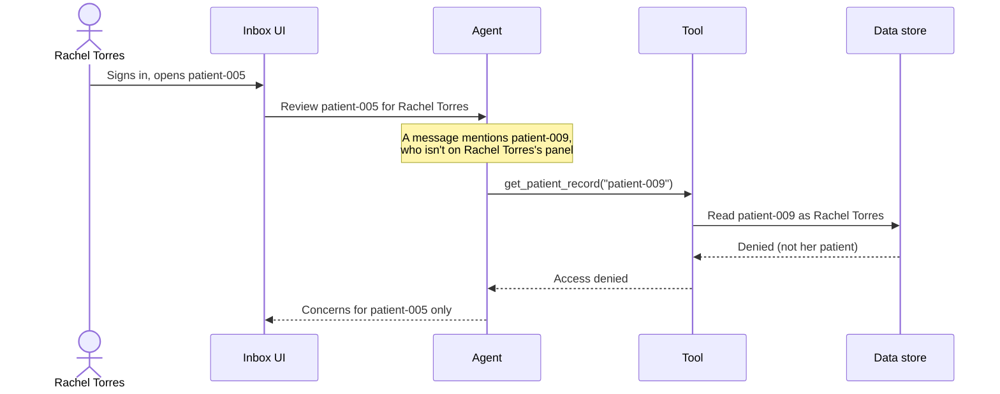

# Lab 4: Securing Data Used By The Agent

**Duration:** ~15 minutes

???+ abstract "What You'll Cover"
    Your agent reads patient records and writes clinical concerns about them. Those concerns are PHI too. This lab is a discussion, not a build: where should agent output live, who should be able to read it, and why do those rules belong in the data layer rather than in the prompt or the UI?

    There's no database to set up. This workshop is a simulation, with synthetic patients, so the patterns here are ones you'll apply when you build with real patient data. To finish, you'll read how the Lab 4 code scopes the agent's tools to one patient and keeps its concerns stable across runs.

---

## Where We Are in the ADLC

Lab 1 built the agent. Lab 2 made it observable. Lab 3 improved its reliability. Lab 4 is **Governance** — ensuring the agent's output is as protected as the data it reads.

The key insight: **agent-generated artifacts are sensitive data too.** The agent reads patient records and produces clinical concerns. Those concerns contain PHI. They need the same access control as the source data — and in a multi-provider practice, they need *more*, because each provider's agent may reach different conclusions about the same patient.

---

## Learning Objectives

By the end of this lab, you will:

- [x] Explain why an agent's output is sensitive data that needs the same protection as its input
- [x] Explain why access control belongs in the data layer, not in the prompt or the UI
- [x] Name the controls a store for agent output needs: row-level security, least-privilege credentials, encryption, audit logging, and retention
- [x] Explain how keeping the clinician's identity attached end to end stops the agent from fetching data the clinician isn't allowed to see
- [x] Connect these patterns to what you've seen in this workshop's simulated environment
- [x] Read how the Lab 4 code scopes agent tools to one patient and keeps concerns stable across runs

---

## Agent Output Is Sensitive Data

A concern like "INR trending up while the patient reports missed warfarin doses" names a medication, a lab result, and something the patient told their doctor. Anyone who reads it learns about that patient's health. The agent didn't copy a record; it **derived** new PHI from several of them.

In Labs 1-3, concerns go to a JSON file on your laptop. Any code path can read or overwrite any patient's concerns, nothing records who looked, and running the agent again replaces the previous run's output. That's acceptable today only because the patients are synthetic.

A real practice adds another problem. Dr. Kim and Rachel Torres may both run the agent on the same patient and get different concerns. Each set reflects the clinician who asked for it. The agent is a **delegate**: its output inherits the identity of whoever invoked it, and access to that output should follow the same rules as access to the patient's chart.

---

## Why the Data Layer, Not the Prompt or the UI

There are four places you could enforce a rule like "Rachel Torres can't see Dr. Kim's concerns":

- **In the prompt.** "Only discuss patients the user is authorized for." A prompt is a request to a model, not a control. Text inside a patient's message can try to override it, and it does nothing about the code that reads the store directly.
- **In the UI.** Hide the rows the user shouldn't see. Every other path to the data skips the filter: an API endpoint, an export script, a debug tool, next quarter's new feature.
- **In the application's queries.** Every query includes `WHERE provider_id = :provider_id`. Forget it once — in an ORM eager-load, a debug endpoint, a migration — and data leaks silently.
- **In the data layer.** The store enforces the rule on every read and write, no matter which code path asks. A new developer can write `SELECT * FROM concerns` and only see what the caller is allowed to see.

Only the last one holds when the code around it changes. The rule lives in one place instead of in every query in the codebase.

---

## Patterns for Protecting Agent Data

None of these are specific to agents. What's specific is that an agent creates new sensitive data quickly, from many sources, on behalf of someone else, so you need all of them in place before the agent's output reaches a real store.

### Row-level security keyed to the caller

Row-level security (RLS) is a database feature that filters rows by a policy attached to the table. The repository's Lab 4 schema shows what a policy for concerns looks like.

!!! example "Illustration only: nothing to run today"
    From `lab4/db/init.sql`:

    ```sql
    ALTER TABLE concerns ENABLE ROW LEVEL SECURITY;

    CREATE POLICY provider_concern_access ON concerns
        FOR ALL
        USING (
            provider_id = current_setting('app.provider_id', true)
            OR id IN (
                SELECT concern_id FROM shared_concerns
                WHERE shared_with = current_setting('app.provider_id', true)
            )
        );
    ```

    A provider sees a concern only if their agent created it, or someone explicitly shared it with them. Dr. Kim's concerns are invisible to Rachel Torres **even though they're in the same table, for the same patients.**

The policy is only as good as the identity it checks. Here, the application sets `app.provider_id` on each connection, so a bug that sets the wrong ID would still leak data. RLS centralizes the filter; it doesn't verify who's asking. In production, the clinician authenticates (for example with OAuth or a signed token), that identity maps to a database role, and the policy checks the role rather than a value the application can get wrong.

### Default deny, explicit grant

The default is isolation: nobody sees a concern unless they own it. Sharing is a deliberate action that writes a grant (here, a row in `shared_concerns` recording who shared what, with whom, and when). That inverts the usual design, where everything is visible and you add filters to restrict it. Access is the exception, and every exception leaves a record.

### Least-privilege credentials

The agent and the application connect with credentials that can do only what they need. In the Lab 4 schema the application connects as `app_user`, not as the database owner, because owners and superusers bypass RLS. Go further in production:

- Give the agent's tools their own credential, limited to the tables and operations they use.
- Keep reporting, migrations, and admin work on separate credentials.
- Keep credentials in a secrets manager or the platform's connection store, not in a `.env` file.

### Encryption at rest and in transit

Use TLS on every hop: UI to API, API to agent, agent's tools to the record system, everything to the store. Encrypt the database, its backups, and any exports, and keep the encryption keys under separate access control. A copied disk or a misplaced backup shouldn't be readable.

### Audit logging of who read what

Record every read and write of PHI: which clinician, which patient, when, and through which path, including requests that were **denied**. HIPAA's Security Rule requires audit controls, and the log is how you answer "who looked at this patient's concerns?" Keep the audit log append-only and separate from the data it describes, so nobody who can change the data can also change the record of it.

### Retention and deletion

Decide how long concerns live, and delete or archive them when the retention period ends. Deleting a concern isn't the end of it: copies also sit in traces, caches, backups, and exports. Each of those stores needs its own retention rule.

### Keep the clinician's identity attached end to end

The agent acts on someone's behalf. If its tools use one powerful service credential, the only thing between a prompt injection and another patient's record is the model's judgment. If every tool call carries the requesting clinician's identity down to the data layer, and the data layer checks it, the agent can only fetch what that clinician could fetch themselves.



Two rules make this work:

- **The identity comes from the session, never from the model.** The agent shouldn't be able to choose who it's acting as. If a tool takes the user's identity as an argument the model fills in, a prompt injection can change it.
- **The check happens below the agent.** The model can be talked into *asking* for anything. The data layer decides what it gets.

---

## How This Maps to Today's Workshop

!!! info "This workshop is a simulation"
    The patients are synthetic, and each attendee works on a private copy of the same practice in a shared workshop EHR. There's no Postgres to configure and no RLS to test today. Here's where the ideas above show up in what you did use.

- **Your patients are separate from everyone else's.** The shared EHR keeps each attendee's copy of the 12 patients apart, keyed to your API key. The server enforces that separation, not your agent's prompt. But the key is a fingerprint of your API key, not a clinician's identity: it separates attendees, not Dr. Kim from Rachel Torres. A real record system would authenticate each user (for example with SMART on FHIR) and check that identity on every request.
- **Your traces hold raw tool output.** When a tool returns a full patient record, Orchestrate's trace records it. Masking the user's input or the agent's final answer doesn't change what the model and the trace already saw: a plug-in that masks the answer runs after the model has read the full record. The one layer that keeps PHI out of the model, the trace, and the answer is the tool returning only the fields the agent needs. That's why Lab 3's focused tools are a security change as well as a quality one. Who can view traces, and for how long they're kept, needs the same decisions as the concerns themselves.
- **Your concerns live in a JSON file on your laptop.** No access control, no audit log, no retention rule. Fine for synthetic data, never for real data.
- **Everyone shares one Orchestrate account, with broad permissions.** That's a shortcut so the whole room could get running in minutes. A real deployment gives each team its own instance and each person only the role they need.

---

## Walkthrough: What the Lab 4 Code Does

!!! note "Read along; there's nothing to run"
    The Lab 4 code in the repository (`lab4/agent/`) adds two protections that don't need a database. Open the files to follow along.

### Tools are scoped to one patient

Open `lab4/agent/tools.py`. Instead of a flat list of tools, there's a factory:

```python
def create_tools(authorized_patient_id: str) -> list:
```

Every data-access tool checks `patient_id == authorized_patient_id` before calling the EHR. If the agent asks for another patient's data, it gets an explicit denial.

Patient Elena Vasquez (patient-005) shows why this matters. One of her messages mentions her neighbor Patricia Kowalski (patient-001) and asks the doctor to check whether they should worry about the same thing. When the agent reviews Elena:

1. It reads Elena's messages and sees the mention of Patricia Kowalski.
2. It calls `list_patients()`, which succeeds: the clinic directory isn't scoped.
3. It may call a data tool for Patricia's patient ID, and gets: `"Access denied: you are only authorized to access patient patient-005"`.
4. It recovers and explains that it can't access other patients' records.

This is **least-privilege tool scoping**. The agent can see who's in the practice but can't pull clinical data for anyone except the patient it was asked about. Scoping in the tool is a good first layer; the identity check in the data layer, described above, is what still holds if a tool has a bug.

???+ note "In production"
    You'd record the denial in your audit log rather than only returning it to the model. The doctor doesn't need to see that the agent tried and failed — but the security team does.

### Concerns are stable across runs

Open `lab4/agent/agent.py` and look at `primary_agent_node`. The agent receives its previous concerns as context:

```
EXISTING CONCERNS (from your previous runs):
[... JSON list of current concerns with IDs ...]

INSTRUCTIONS FOR EXISTING CONCERNS:
- If an existing concern is still valid, include it with the SAME id.
- If you find a new concern, create it with a new unique id.
- Concerns you omit will remain in the store unchanged.
```

The store then updates concerns by ID instead of replacing the whole list, so running the agent twice builds on the previous run instead of wiping it out. Stable IDs matter for security as well as usability: an audit log, a share grant, or a retention rule can only point at a concern if its ID doesn't change every run.

`lab4/agent/store.py` also contains a Postgres version of the store that sets `app.provider_id` on each connection, so the RLS policy above applies. Read it alongside `lab4/db/init.sql` if you want to see the policy wired up.

---

## Taking It to Production

A production deployment would add several layers. Because we've used structured outputs consistently — every concern is a typed Pydantic model with explicit fields — many of these are easier to implement than they'd be in a fully unstructured system.

- **Real authentication.** Each clinician signs in, and that identity flows through the agent to the data layer, as described above. No dropdowns, no shared keys, no identity the application can set wrong.
- **Input hardening.** Tool scoping prevents cross-patient data access, but the agent could still be influenced by adversarial content within the authorized patient's data. Defense-in-depth (output validation from Lab 3 plus input sanitization) is needed.
- **Granular sharing.** A real system might need time-limited shares, read-only versus read-write access, or approval workflows. Structured concerns make this straightforward: the schema already separates the fields you'd want to control access to.
- **Deterministic reconciliation.** The agent *usually* reuses existing concern IDs, but it's not guaranteed. A production system would add a post-agent step that matches concerns by content rather than trusting the LLM to preserve IDs. Structured output makes this feasible — you can compare typed fields instead of parsing free text.
- **Trace access and retention.** Traces are a second copy of everything the agent saw. Limit who can view them, mask or minimize what goes in, and set a retention period, using the same identity that controls access to concerns.

---

## What Did We Learn?

| Principle | Implementation |
|---|---|
| **Agent output is PHI** | Concerns get the same protection as the records they're derived from |
| **Centralized access control** | A row-level security policy in the data layer filters every query, instead of scattered `WHERE` clauses |
| **Agent output inherits identity** | Concerns belong to the clinician who ran the agent |
| **Default deny, explicit grant** | Nobody sees a concern by default; sharing creates a recorded exception |
| **Identity end to end** | The clinician's identity, not the model, decides what the agent's tools can fetch |
| **Least-privilege tools** | The agent can only access the patient it was asked about |
| **Stable artifacts** | Concerns persist across runs — update by ID, not replace wholesale |

---

## Workshop Complete

| Lab | Problem | Solution |
|---|---|---|
| ~~[Lab 1](lab-1.md)~~ | ~~No structure, no tools, just vibes~~ | ~~A ReAct agent with structured output~~ |
| ~~[Lab 2](lab-2.md)~~ | ~~No visibility into agent behavior~~ | ~~Observability: tracing and PII masking~~ |
| ~~[Lab 3](lab-3.md)~~ | ~~Unstable output, hallucinations, overstepping~~ | ~~Evaluation: focused tools, critic loop, grounding checks~~ |
| ~~[Lab 4](lab-4.md)~~ | ~~Unrestricted data access, no isolation~~ | ~~Security: data-layer access control, scoped tools, stable concerns~~ |

???+ success "You're done!"
    You've built an agent, made it observable, improved its reliability, and worked through how to protect the data it reads and writes. Check out the [Additional Resources](./resources.md) for further reading and frameworks to take this further.
