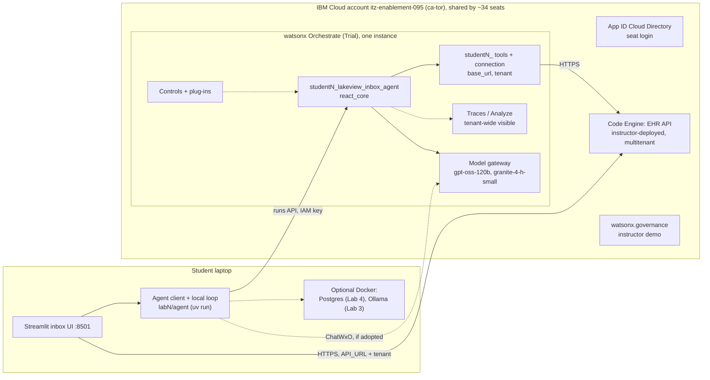
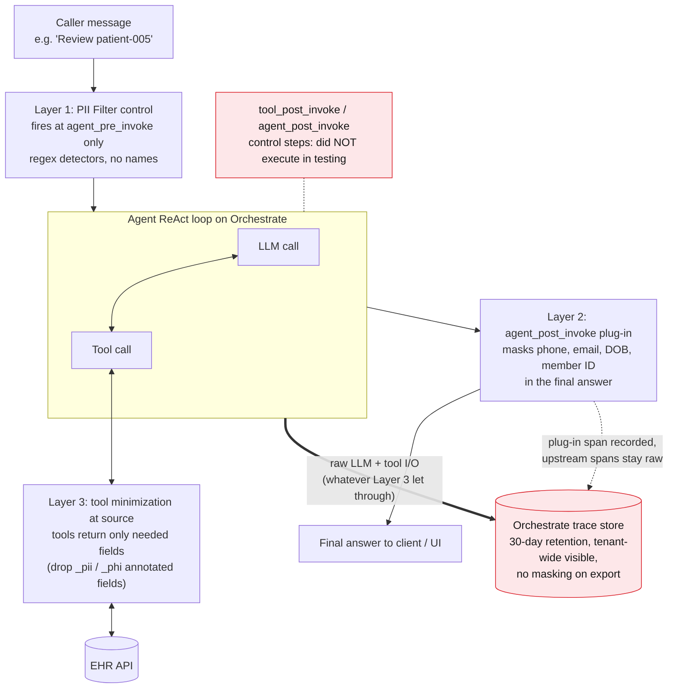
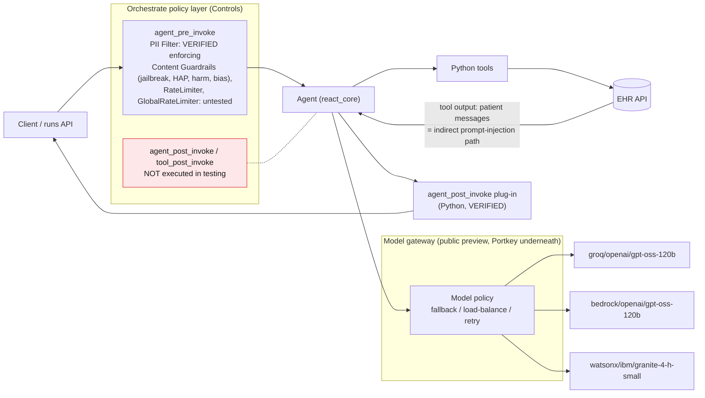
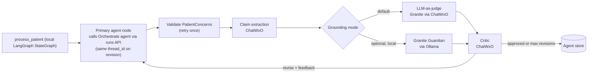
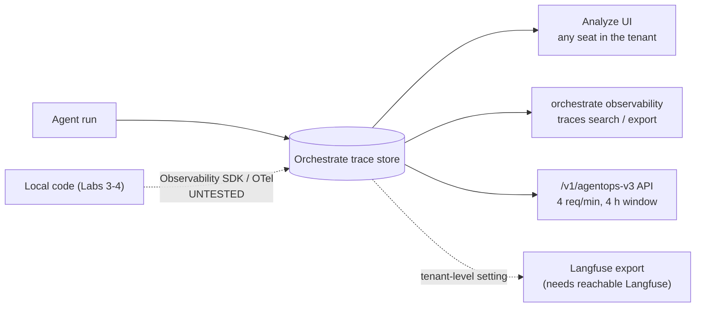

# TXC 2026 AI Agents Workshop: IBM Cloud capability map and feature review

Date: 2026-10-22. Scope: the IBM edition (`docs/ibm/content/`) and code on branch `ibm/student-setup`. This review is read-only: nothing was deployed and no remote resources were changed.

**Evidence labels**

| Label | Meaning |
|---|---|
| **[VE]** verified-earlier | Established in earlier probing of the TechZone tenant (see the task brief and memory notes) |
| **[VD]** verified-in-docs | Read in primary IBM docs today (URL given) |
| **[VA]** verified-in-ADK | Seen in local ADK 2.19.0 `--help` output or installed package source |
| **[VR]** verified-in-repo | Read in this repository today (added so repo facts aren't mixed up with platform facts) |
| **[?]** uncertain | Not verified. Treat as a hypothesis to test before relying on it |

---

## 0. Headline findings

1. **Only Lab 1 has moved to IBM.** Labs 2–4 still run LangGraph locally against Gemini, OpenAI or Anthropic through `app/llm.py`, with no watsonx provider [VR]. `prerequisites.md` §4 still tells students to buy an OpenAI key [VR]. For the IBM story, Labs 2–4 need an IBM-hosted LLM path. The cheapest one is **`ChatWxO`** from `ibm-watsonx-orchestrate-sdk`, a LangChain chat model that routes through Orchestrate using the seat's existing `WXO_API_KEY`. It supports `bind_tools`, `with_structured_output` and streaming [VD: https://developer.watson-orchestrate.ibm.com/sdk/chat_wxo.md]. It's on PyPI as 2.19.0 and depends on `langchain-openai>=1.1`, which matches the locked `langchain-openai 1.2.1` [VR]. **It hasn't been tested against this tenant [?].** That needs a 10-minute spike before anything else.
2. **The docs don't match the code or the environment.**
    - `lab-1.md` still teaches `create_react_agent` and "constrained decoding guarantees valid JSON", but Lab 1 now runs on Orchestrate `react_core`, where structured output isn't enforced [VE][VR].
    - `environment-topology.md` assumes one Linux VSI per participant with Docker, Langfuse, Postgres and Ollama [VR]. The TechZone deployment has **no VSIs** in its resource list, only Orchestrate, Code Engine, watsonx.ai Runtime and Studio, governance, COS and App ID [VE].
    - `prerequisites.md` assumes the student's own laptop (brew/apt, Docker Desktop) [VR].
    - **Decision needed:** where do Streamlit, Docker, Langfuse, Postgres and Ollama run? If the answer is student laptops, Labs 2–4 inherit "Docker on 34 random laptops" risk. If it's "nowhere", Labs 2–4 must be IBM-native or instructor-demo.
3. **Lab 1 data split.** Students' Orchestrate tools call the shared Code Engine EHR API, but `app/ui.py` auto-starts a *local* EHR API unless `API_URL` is set [VR]. Replies made in the UI therefore land in a different copy of the data from the one the agent reads.
    - The new "multitenant EHR API" plan contradicts the 2026-10-21 plan doc, which rejected multitenancy [VR]. It's the right call now, but `app/api.py` and `app/store.py` are single-tenant and file-backed today [VR].
    - The per-seat connection that `deploy.py` already creates is the natural place to carry the tenant key. It's a key-value connection with a prefixed `app_id` [VR]. Add `tenant=<prefix>` next to `base_url`.
4. **The PII story is strong if it's told honestly as three layers.** Input control (PII Filter, which only fires at `agent_pre_invoke`) + tool minimization at source + output plug-in (`agent_post_invoke`) [VE]. The lesson is that **the trace store still holds raw PII** between those layers, and traces are tenant-wide visible [VE]. That's Lab 2's "your trace store is a secondary PHI repository" point, shown live on IBM's product.
5. **Best low-effort "IBM in its best light" additions:**
    - (a) `orchestrate evaluations red-teaming`, OWASP-mapped attacks against native agents [VA][VD], in Lab 4.
    - (b) Granite as the critic/judge model through Orchestrate (a different model family from the primary gpt-oss), in Lab 3.
    - (c) Orchestrate's built-in Analyze traces replacing Langfuse, in Lab 2.
    - (d) Context variables to pass the authorized patient and provider out of the LLM's reach, in Lab 4.
    - (e) An instructor-only slide/demo of watsonx.governance AI Risk Atlas and agent monitoring.
6. **Avoid:** student-imported LangGraph agents (tenant cap of **10 LangGraph agents**; ~34 seats) [VD]; embedded web chat/channels (contradicts the workshop's own "why not chat" argument); agentic-workflow rewrites of Lab 3 (too much effort for a few days); workspaces (blocked by `428 TRUSTED_PROFILE_ID`) [VE].

---

## A. Capability map: what the workshop uses today and its IBM Cloud equivalent

Status key: **works-as-is** · **needs-change** · **keep-OSS** (no equivalent, keep the open-source part) · **unknown**. "Available here" means the TechZone account `itz-enablement-095` (ca-tor) with a student seat.

### Cross-cutting / platform

| # | Capability today (evidence) | IBM Cloud equivalent | Available here? | Status | Teaching impact / what must change |
|---|---|---|---|---|---|
| X1 | **LLM provider abstraction** `app/llm.py`: Gemini (default), OpenAI, Anthropic via LangChain [VR] | (a) **`ChatWxO`** via Orchestrate model gateway [VD chat_wxo]; (b) `langchain-ibm` `ChatWatsonx` on watsonx.ai Runtime `pm-20` | (a) yes, same `WXO_API_KEY` [?]; (b) seats have Runtime/Studio Editor, but need a project/space and a first Studio login to get a profile [VE] | **needs-change** | Add `LLM_PROVIDER=wxo` branch to `get_chat_model()` using `ChatWxO.from_instance_credentials(instance_url, api_key, model)`. Use one model ID shared with Lab 1 (`groq/openai/gpt-oss-120b`) plus `watsonx/ibm/granite-4-h-small` for judge/critic [VE models]. Remove "buy an OpenAI key" from prerequisites. Keep Gemini/OpenAI as off-site fallback. |
| X2 | **Models**: `gpt-4o-mini`, `gemini-2.5-flash-lite`, `claude-haiku-4-5` [VR]; Lab 1 uses `groq/openai/gpt-oss-120b` [VR] | Orchestrate model list: groq/ and bedrock/ gpt-oss-120b, `watsonx/ibm/granite-4-h-small`, Llama, Mistral [VE] | yes [VE] | **works-as-is** (Lab 1) / **needs-change** (2–4) | Run-to-run variance on gpt-oss-120b (it sometimes stops after one tool call) [VR plan doc]. Pre-test Labs 3–4 prompts on it. |
| X3 | **Model reliability**: none | **Model policies** / gateway (`orchestrate models policy`; fallback, load-balance, retry; Portkey underneath; public preview) [VE][VA][VD https://developer.watson-orchestrate.ibm.com/llm/model_policies.md] | yes [VE] | optional | Reliability, not responsibility. One slide plus the gateway diagram (§C2). Don't make students create policies, because model names are tenant-global [?]. |
| X4 | **`scripts/check_llm.py`**: `get_chat_model().invoke("Say hello…")` [VR] | Same script via `ChatWxO`; `scripts/ibm_cloud_login.py` already checks reachability [VR] | yes | **needs-change** | Works unchanged once X1 lands. |
| X5 | **Seat login / identity** | **App ID** Cloud Directory → IBM Cloud IAM; seat creates API key; `ibm_cloud_login.py` writes `WXO_API_KEY`, `WXO_INSTANCE_URL`, `WXO_NAME_PREFIX` [VE][VR] | yes | **works-as-is** | Script does not set `EHR_API_URL`, which `deploy.py` needs [VR]. Instructor must hand it out (or the script should write it). |
| X6 | **Docker Compose** services: Langfuse (6 containers), Postgres 16 [VR] | No per-student compute in this account [VE]. Code Engine exists but seats can't build from source (ICR Free plan, no ICR platform Administrator) [VE] | **no** (unless laptops) | **needs-change / decision** | See topology ambiguity (§0.2). CE *can* run a pre-built public image, so the instructor could host shared services. Postgres-per-student doesn't fit that. |
| X7 | **EHR API** (`app/api.py`, FastAPI, file-backed, single-tenant) [VR]; Dockerfile `deploy/ehr-api/Dockerfile` [VR] | **Code Engine** app, instructor-deployed [VE] | yes (instructor) | **needs-change** | Make it multitenant: tenant from header/path, per-tenant copy of `data/patients` (in-memory or COS). Tools send tenant from their connection. Set `API_URL` for the UI so UI and agent share the same data. Unauthenticated/public is acceptable for synthetic data [VR plan doc], but say so on a slide. |
| X8 | **Streamlit UI** `app/ui.py` (local, auto-starts local API) [VR] | No IBM UI equivalent that preserves the inbox design. Orchestrate chat/web chat is a *chat* UI | n/a | **keep-OSS** (runs on laptop) | Requires Python + uv on laptops. Must point at shared EHR API (X7). |
| X9 | **Agent API** `labN/agent/api.py` on :8001 (run, masking toggle, grounding toggle, roles) [VR] | Orchestrate runs API (`POST /v1/orchestrate/runs`, poll) is wrapped by `lab1/agent/agent.py` [VR] | yes | **works-as-is** (Lab 1) | Toggles that flip in-process flags (masking, grounding) have no runtime equivalent on a hosted agent. They become "deploy variant A vs B" (re-import agent). See Lab 2. |

### Lab 1: The naive agent

| # | Capability today | IBM equivalent | Available? | Status | Teaching impact / change |
|---|---|---|---|---|---|
| 1.1 | **ReAct agent** (`create_react_agent`) [VR docs] | Orchestrate native agent, `style: react_core` (`lab1/agent/agent.yaml`) [VR][VE] | yes | **works-as-is** (code) / **needs-change** (docs) | Rewrite `lab-1.md` Step 2 ("Open agent.py… create_react_agent") and slide "Why LangGraph?" for Orchestrate. Mention ~30 s–4 min **tool cold start** after import [VR plan doc]. |
| 1.2 | **Tools** via `@tool`, HTTP to EHR API [VR] | ADK Python tools + key-value connection holding `base_url`, per-seat prefix [VR][VE] | yes | **works-as-is** | Good teaching contrast: tools now run *in IBM's cloud*, so they can't reach `localhost`. |
| 1.3 | **Structured Outputs / constrained decoding** (`response_format=PatientConcerns`) [VR docs] | Not enforced on `react_core`; `llm_config.response_format` breaks runs [VE]. Current approach: schema appended to instructions + validate + 1 retry (5/6 first-try valid) [VR] | partial | **needs-change** (docs) | Reframe the lesson as "**the platform doesn't guarantee structure, so the contract is enforced by your code**" (Pydantic validation + retry). That's honest and still teaches the point. Optional idea [?]: a typed `submit_concerns` tool whose argument schema is the contract. |
| 1.4 | **Output contract** `app/models.py` `Concern` [VR] | Same (client-side Pydantic) | yes | **works-as-is** | — |
| 1.5 | **JSON agent store** (relative per-lab path) [VR] | Laptop file; COS possible but pointless | yes | **works-as-is** | Keep. |
| 1.6 | Seeing the agent in a product UI | Orchestrate **Build → agent preview chat**; agent is a draft [VR plan doc] | yes | **works-as-is** | Nice "IBM in best light" moment: students open their own `studentN_lakeview_inbox_agent` in the UI. |

### Lab 2: Observability

| # | Capability today | IBM equivalent | Available? | Status | Teaching impact / change |
|---|---|---|---|---|---|
| 2.1 | **Langfuse tracing** via LangChain `CallbackHandler`, self-hosted Docker [VR] | **Orchestrate traces**: built-in, no-code; spans for runs, LLM calls (model, tokens), tool calls with full I/O; Analyze UI, `orchestrate observability traces search/export`, API `/v1/agentops-v3/...` [VE][VA][VD https://developer.watson-orchestrate.ibm.com/traces/overview.md] | yes | **needs-change** (rewrite lab) | "Three lines of code" becomes "**zero lines of code**", a good IBM story. API limits (4 req/min, ≤4 h window, 30-day retention) [VE] mean students should use the **Analyze UI**, not scripts. |
| 2.2 | **Sessions / tags** (`langfuse_session_id`, `langfuse_tags`) [VR] | Orchestrate thread IDs; agent-name filter in Analyze [VE partial]. No free-form tags [?] | partial | **needs-change** | Filter by seat-prefixed agent name. Drop the tag exercise. |
| 2.3 | **Cost tracking** (Langfuse auto cost) [VR] | Token counts but **no cost** in Orchestrate spans [VE] | no | **needs-change** | Make it a pencil exercise: tokens × list price. Keep the "$100/month per practice" question. |
| 2.4 | **Datasets / annotations / scores** (Langfuse UI) [VR] | `orchestrate evaluations record` builds test cases from chats [VE][VA]; Analyze feedback [?] | partial | **needs-change** | Replace with "record a test case" (forward pointer to Lab 3 evals). |
| 2.5 | **Client-side PII masking** (Presidio NER + Pydantic `_pii/_phi` field annotations), before data leaves the process [VR] | **Not possible for hosted agent traces**: tools run in Orchestrate, no PII masking on export, no custom spans [VE]. Available layers: **PII Filter control** (input only, regex, no names) [VE]; **post-invoke plug-in** masks final answer [VE][VD https://developer.watson-orchestrate.ibm.com/plugins/plugins.md]; **tool minimization** at the EHR API/tool [design]; *flow* `mask_property` masks in "logs, traces, and the flow inspector", for agentic workflows only, string properties only [VD https://developer.watson-orchestrate.ibm.com/tools/flows/masking_sensitive_data.md][?] | partial | **needs-change** | This is the key rewrite. Teach the three layers (diagram §C1), then show the trace still contains raw PII. **Field annotations survive as tool minimization**: tools drop `_pii/_phi` fields before returning, so they never reach the LLM or the trace. Presidio stays only in the optional local path (2.7). |
| 2.6 | **Masking toggle** in UI (runtime flag) [VR] | Two agent variants (with/without plug-in, with/without control) [VE] | yes | **needs-change** | Replace toggle with "re-deploy with `--masking`" (`deploy.py` flag). Allow for tool cold start. |
| 2.7 | Trace visibility / RBAC (Lab 4 "Langfuse RBAC") [VR] | Traces **tenant-wide visible** to all seats [VE]; workspaces would isolate but creation fails `428 TRUSTED_PROFILE_ID` [VE] | no isolation | **needs-change** (turn into a lesson) | Live demo: "find another student's trace". Synthetic data makes this safe, and it shows why trace access control matters. |
| 2.8 | (new option) Local LangGraph code → IBM traces | **Observability SDK** decorators (`@trace_agent_call/@trace_llm_call/@trace_tool_call`) or plain **OTel export** into Analyze for agents running outside Orchestrate; requires a registered `kind: external` agent, tenant ID, and on IBM Cloud a **workspace ID** [VD https://developer.watson-orchestrate.ibm.com/traces/observability-sdk.md, …/traces/otel-export.md] | [?] (workspace ID of default workspace unknown) | **unknown** | If it works, Labs 3–4 local code can trace into the same Analyze UI, and **client-side masking (Presidio) applies again** because you build the span payload. Spike before promising. |
| 2.9 | Langfuse export from Orchestrate | Tenant-level Langfuse export (`orchestrate settings observability`) [VE][VA] | needs reachable Langfuse | **keep-OSS / skip** | One tenant-level setting for 34 students, so no per-student config. Skip. |

### Lab 3: Improving the agent

| # | Capability today | IBM equivalent | Available? | Status | Teaching impact / change |
|---|---|---|---|---|---|
| 3.1 | **Focused keyword search tools** replace dump-all [VR] | Same as ADK Python tools [VE] | yes | **works-as-is** (port tools) | Port `lab3/agent/tools.py` to ADK `@tool` with connection. Big PHI-in-traces reduction, which ties to 2.5. |
| 3.2 | **Critic / revision loop** (LangGraph `StateGraph`: primary → extract claims → grounding → critic → revise) [VR] | Options: (a) **keep the local StateGraph**; primary node calls the Orchestrate agent via runs API (reuse `lab1` client, same `thread_id` for revisions); extractor/judge/critic via `ChatWxO`; (b) collaborator agents (critic as collaborator) [VA `--collaborators`]: LLM decides when to call the critic, so the loop isn't deterministic; (c) agentic workflow (agent node, generative prompt node, foreach, branch) [VD https://developer.watson-orchestrate.ibm.com/tools/flows/overview.md] | (a) yes [?]; (b) yes; (c) yes | **needs-change**, recommend (a) | (a) keeps the lab's code-reading pedagogy and shows a hosted agent inside a governed loop. Avoid (c) for this event. |
| 3.3 | **Structured output for judge/critic** (`with_structured_output`) [VR] | `ChatWxO.with_structured_output` [VD]; whether it's *constrained* on gpt-oss/granite via the gateway is [?] | [?] | **unknown** | Spike; fall back to `method="function_calling"` + validation. |
| 3.4 | **Grounding: LLM-as-judge** [VR] | Same via `ChatWxO`, with **Granite** as the judge (different model family from gpt-oss, which lowers self-evaluation bias) [VE models] | yes [?] | **needs-change** (small) | Strong IBM story with low effort. |
| 3.5 | **Grounding: Granite Guardian via Ollama** (optional) [VR] | Hosted Guardian model **withdrawn** (ca-tor never had it) [VE]. Candidates: watsonx.ai `/ml/v1/text/detection/context` (summary: "Detection task on input content based on context documents") [VD https://cloud.ibm.com/apidocs/watsonx-ai] with `granite_guardian` detector billed to governance (UNTESTED) [VE]; `ibm-watsonx-gov` `FaithfulnessMetric(method=granite_guardian)` [VE], but seat gets 403 on data_marts [VE] | uncertain | **unknown / keep-OSS** | Keep Ollama as optional local path. Only promote the detection API if a spike from a *seat* key succeeds. |
| 3.6 | **Offline evaluation** (not in lab today) | `orchestrate evaluations evaluate`, `quick-eval`, **rubric** LLM-as-judge (e.g. `no_hallucination`) on draft agents [VE][VA][VD https://developer.watson-orchestrate.ibm.com/evaluate/rubric.md] | yes | optional add | Nice 5-minute "regression test your agent" step (feature B4). |
| 3.7 | **Langfuse `@observe` named spans** (Primary Agent, Claim Extraction, Grounding…) [VR] | Orchestrate trace for the hosted agent part; local spans need 2.8 [?] or stay in Langfuse | partial | **needs-change** | Without 2.8, students see the agent run in Analyze and the loop in terminal logs. Acceptable but weaker. |

### Lab 4: Securing data

| # | Capability today | IBM equivalent | Available? | Status | Teaching impact / change |
|---|---|---|---|---|---|
| 4.1 | **Postgres 16 + RLS** (Docker, `lab4/db/init.sql`, `set_config('app.provider_id')`) [VR] | **Databases for PostgreSQL** supports RLS (it's Postgres) but **no instance in this account** [VE resource list]; seats creating one is [?] and costly. watsonx.data was considered [VR topology] but isn't provisioned | no | **keep-OSS** | Options: laptop Docker (current), or fall back to the JSON store (the lab already documents "No Docker?") [VR]. Or the instructor demos RLS. Don't migrate to IBM for this event. |
| 4.2 | **Tool scoping** (`create_tools(authorized_patient_id)` closure) [VR] | Orchestrate tools can't be closures per run. Equivalent: **context variables** / `AgentRun.request_context`, JWT-trusted, passed by the caller; the tool reads the authorized patient from context, not from LLM args [VE][VD https://developer.watson-orchestrate.ibm.com/conversation/context_variables.md] | yes [VE] | **needs-change** | This is *better* teaching than today: the authorization comes from the caller's identity and the LLM can't forge it. |
| 4.3 | **Simulated roles** (dropdown → `set_config`) [VR] | Context variable `provider_id` from the trusted caller; per-user (`member`) connections / OAuth for real identity [VE] | yes | **needs-change** | Keep dropdown for the UI. Pass provider as context variable to the agent run. |
| 4.4 | **Concern stability** (previous concerns in prompt, upsert by ID) [VR] | Same (client-side) | yes | **works-as-is** | — |
| 4.5 | **Adversarial test** (Elena → Patricia cross-patient) [VR] | Same, plus **`orchestrate evaluations red-teaming`** (native agents only) [VA][VD https://developer.watson-orchestrate.ibm.com/evaluate/llm_vulnerability.md] | yes [?] (runs via LLM, needs seat env) | optional add | See B3. |
| 4.6 | **Input hardening** ("in production…") [VR] | **Controls**: Content Guardrails (jailbreak/HAP/harm/bias), SecretsDetection, SQLSanitizer, RateLimiter, … [VE][VA][VD https://developer.watson-orchestrate.ibm.com/controls/managing_controls.md] | yes, seats can create [VE] | optional add | Important caveat: the agent's injection risk here is **indirect, via tool output** (patient messages), and post-invoke/tool-post controls didn't execute in testing [VE]. Input guardrails therefore don't cover this threat. That's a valuable and honest lesson. |
| 4.7 | `scripts/reset_db.py` [VR] | — | — | **keep-OSS** | Only with Docker Postgres. |

---

## B. Other Orchestrate / governance / watsonx.ai features worth considering

Ratings: **Value** (teaching + IBM showcase) H/M/L · **Effort** for the instructor before the event · **Arc fit** = Build / Observe / Improve / Secure.

| # | Feature | Exists? (evidence) | Value | Effort | Arc fit | Risks / notes | Recommendation |
|---|---|---|---|---|---|---|---|
| B1 | **`ChatWxO`** LangChain model via Orchestrate | [VD chat_wxo.md]; PyPI `ibm-watsonx-orchestrate-sdk` 2.19.0 | **H**: removes all non-IBM LLM keys from the workshop | S (one branch in `app/llm.py`) | all | Untested on this tenant. Gateway endpoint `/v1/orchestrate/gateway/model/chat/completions` is listed as "Pure Passthrough" in the OpenAPI spec [VD server_openapi.json]. Concurrency/rate limits for 34 seats on Trial [?] | **Do first (spike today).** |
| B2 | **Granite as judge/critic** (`watsonx/ibm/granite-4-h-small`) | [VE] in model list | H | S | Improve | Granite 4 H Small quality as a structured judge is untested [?] | Do, if B1 works. |
| B3 | **Red-teaming** `orchestrate evaluations red-teaming list/plan/run`; 15 attacks mapped to OWASP LLM Top 10 (prompt injection, prompt leakage, crescendo, encoded input…) | [VA][VD llm_vulnerability.md]; "only with native agents" | **H**: rare, concrete, IBM-specific | M (needs dataset + agents path; try `list`/`plan` once) | Secure | Runtime and LLM cost per student [?]. Attacks target user input; our threat is indirect injection [VE controls finding]. Say so | Instructor demo or optional step in Lab 4. |
| B4 | **Evaluations** `evaluate` / `quick-eval` / rubric (`no_hallucination`) / `record` / `generate` | [VA][VD …/evaluate/rubric.md][VE] | M–H | M | Improve | Draft agents only [VE]. Test cases need ground truth | Optional Lab 3 step: "turn one Lab 2 run into a regression test". |
| B5 | **Controls** (Content Guardrails jailbreak/HAP, PII Filter, RateLimiter…) | [VE][VA][VD managing_controls.md] | H | S | Secure / Observe | PII Filter input-only, no names [VE]. Controls are tenant objects, so prefix names | Use in Lab 2 (PII layer 1) and Lab 4 (jailbreak guardrail, plus the caveat). |
| B6 | **Plug-ins** (`agent_pre_invoke` / `agent_post_invoke` Python) | [VE tested][VD plugins.md] | H | S (already tested) | Observe / Secure | Doesn't clean traces upstream [VE] | Lab 2 layer 3. |
| B7 | **Context variables** (caller identity into tools) | [VE][VD context_variables.md] | H | M | Secure | Need to pass via runs API from `agent.py` client | Lab 4 tool scoping (4.2). |
| B8 | **Analyze dashboards / agent monitoring** (success, latency, tokens; "powered by integration with watsonx.governance") | [VD https://www.ibm.com/new/announcements/now-ga-monitor-agents-in-runtime-in-watsonx-orchestrate] (GA Dec 2025; requires agent deployed to production); API `/v1/orchestrate/monitoring/agents/{id}/status` [VD server_openapi.json] | M | S for a demo | Observe | Draft-only agents may not show in monitoring [?]. Deploying 34 live agents is tenant-limited [?] | Instructor demo with one deployed agent. |
| B9 | **watsonx.governance AI use case + AI Risk Atlas** | Risk Atlas page has "New and amplified risks of agentic AI" (e.g. function-calling hallucination; sharing PI with tools; untraceable actions) [VD https://www.ibm.com/docs/en/watsonx/saas?topic=ai-risk-atlas]; use-case/inventory UI on this Essentials instance [?]; Orchestrate↔governance "Agent Platforms" integration described only in a community blog [?] | **H** for responsible-AI framing | S (slides) / M–L (live) | Secure (wrap-up), slides | Seat has no watsonx profile until first Studio login; 403 on data_marts [VE] | Map each lab's failure mode to Risk Atlas entries on a slide. Skip the live governance console unless the instructor pre-tests it. |
| B10 | **ibm-watsonx-gov SDK metrics** (Faithfulness llm_as_judge/granite_guardian, tool-call accuracy, HAP/PII) | [VE]; agentic evaluation docs [VD https://au-syd.dai.cloud.ibm.com/docs/content/wsj/model/wxgov-agentic-ai-evaluation-sdk.html?context=wx] | M | M–L | Improve | 403 data_marts from seats [VE]; credentials/setup per seat [?] | Instructor-only, or skip. |
| B11 | **Agentic workflows (flows)**: agent/tool/script/branch/foreach/generative-prompt/user-activity nodes; `mask_property` masks in traces | [VD flows/overview.md, masking_sensitive_data.md][VA flow_builder] | M (deterministic evaluator; trace masking) | **L** (high) | Improve / Observe | New authoring model mid-workshop; masking is string-only | Mention as "production path" on a slide. Don't build. |
| B12 | **Human-in-the-loop** (flow user-activity node, `enable_review`) | [VD user_activities_node.md][VA `enable_review` in flow_builder/types.py] | M | L | Secure | Doctor-in-the-loop already exists via the inbox UI | Slide only. |
| B13 | **Scheduling** (`is_schedulable=True`; schedules via Chat UI) | [VD https://developer.watson-orchestrate.ibm.com/scheduling/overview.md] | M ("background agent" made real) | M | Build | Schedule creation is via natural-language chat; output still has to reach our store | Slide mention in Lab 1 "background agents". |
| B14 | **Collaborator agents** (multi-agent) | [VA `--collaborators`][VD import_agent.md] | M | M | Improve | Non-deterministic critic invocation | Slide contrast with Lab 3's explicit loop. |
| B15 | **LangGraph (custom) agents on Orchestrate** | [VD https://www.ibm.com/docs/en/watsonx/watson-orchestrate/base?topic=agents-importing-langgraph]; [VA `--package-root`, `style custom`]. **Limit: 10 per tenant**; tools inside are not Orchestrate tools; controls/tracing behaviour not documented | M | M | Build | 34 seats > 10 cap | Instructor demo at most ("bring your LangGraph code"). |
| B16 | **Knowledge bases** (RAG) | [VA `knowledge-bases`][VD knowledge_base/overview.md] | L–M (e.g. clinic triage protocol doc) | M | Improve | Adds a new concept, scope creep | Skip. |
| B17 | **MCP toolkits / OpenAPI tools** (`toolkits add -k mcp`, `tools import -k openapi`) | [VA][VD tools/toolkits/overview.md] | M ("import the EHR API's OpenAPI spec as tools") | S–M | Build | OpenAPI import exposes *all* endpoints, which is the opposite of Lab 3/4's minimization lesson. Useful as an anti-pattern | Optional discussion. |
| B18 | **Channels / embedded web chat** | [VA `channels webchat`][VD webchat/get_started.md] | L (conflicts with the workshop's "why not chat" stance) | M | — | Undercuts core design argument | **Don't.** Mention as what the inbox UI deliberately avoids. |
| B19 | **External agents / A2A** (`agents discover`, `kind: external`) | [VA][VD connect_agent.md] | L | M | — | — | Skip (except as prerequisite for 2.8 traces). |
| B20 | **Guidelines** (when-condition-then-action, extra LLM call per turn) | [VD build_agent.md "Guidelines"] | M (e.g. "when a message asks for a diagnosis → flag, don't answer") | S | Improve | Extra latency/cost [VD] | Optional Lab 3 one-liner to curb overstepping. Compare with the critic. |
| B21 | **Skills** (`orchestrate skills`, SKILL.md) | [VA] | L | M | — | New concept | Skip. |

---

## C. Architecture diagrams to add

Suggested placement: C0 replaces the diagram in `environment-topology.md`; C1 goes in `lab-2.md` (and a slide); C2 goes in a slide before Lab 4 or in `resources.md`; C3 goes in `lab-3.md`; C4 goes in `lab-2.md` Step 7.

### C0. TXC 2026 topology (shared account, no VSIs)

### C1. PII layering (verified behaviour)

Teaching line: *only Layer 3 (minimizing at the source) keeps PII out of the trace store.* Layers 1 and 2 protect what goes in and comes out, not what is recorded in between.

### C2. Gateway and controls (where policy can act)

Teaching line: the gateway handles **reliability**; controls handle **input policy**. Neither inspects tool output, which is where this agent's injection risk actually comes from.

### C3. Lab 3 hybrid evaluation loop (recommended option 3.2a)

### C4. Where observability data lives and who sees it

---

## D. Suggested minimal plan for the next few days

1. **Spike (1–2 h, instructor):**
    - `ChatWxO` from a seat key: plain invoke, `bind_tools`, `with_structured_output(PatientConcerns)`, a burst of ~10 parallel calls.
    - Runs-API call with a context variable.
    - `orchestrate evaluations red-teaming list`.
    - If any of these fail, keep the external-provider fallback for Labs 2–4 and say so.
2. **Multitenant EHR API** on Code Engine, plus `API_URL`/tenant in `.env` from `ibm_cloud_login.py`.
3. **Docs:**
    - `lab-1.md`: Orchestrate, the structured-output reframe, cold start.
    - `lab-2.md`: Orchestrate traces + three-layer PII + the tenant-wide visibility lesson + tokens-only cost.
    - `environment-topology.md`: C0, and remove the VSI assumption.
    - `prerequisites.md`: drop the OpenAI/Gemini section from the IBM edition. Scope Docker/Ollama as optional.
4. **Lab 3:** keep the code structure; swap `get_chat_model()` to `ChatWxO` and primary node to the Orchestrate client; Granite as judge.
5. **Lab 4:**
    - Keep RLS on laptop Docker with the documented JSON fallback.
    - Add context-variable tool scoping.
    - Add a jailbreak Content Guardrail + red-teaming demo, with the indirect-injection caveat.
6. **Slides:** AI Risk Atlas mapping on the wrap-up slide. Mention flows/HITL/scheduling/governance monitoring as "production path".

## Sources (primary)

- ADK docs index: https://developer.watson-orchestrate.ibm.com/_llms/2-x.txt
- ChatWxO: https://developer.watson-orchestrate.ibm.com/sdk/chat_wxo.md · PyPI: https://pypi.org/project/ibm-watsonx-orchestrate-sdk/
- Traces: https://developer.watson-orchestrate.ibm.com/traces/overview.md · Observability SDK: https://developer.watson-orchestrate.ibm.com/traces/observability-sdk.md · OTel export: https://developer.watson-orchestrate.ibm.com/traces/otel-export.md
- Controls: https://developer.watson-orchestrate.ibm.com/controls/managing_controls.md · Plug-ins: https://developer.watson-orchestrate.ibm.com/plugins/plugins.md
- Context variables: https://developer.watson-orchestrate.ibm.com/conversation/context_variables.md
- Model policies: https://developer.watson-orchestrate.ibm.com/llm/model_policies.md
- Evaluations: https://developer.watson-orchestrate.ibm.com/evaluate/overview.md · Rubric: https://developer.watson-orchestrate.ibm.com/evaluate/rubric.md · Red-teaming: https://developer.watson-orchestrate.ibm.com/evaluate/llm_vulnerability.md
- Flows: https://developer.watson-orchestrate.ibm.com/tools/flows/overview.md · Flow masking: https://developer.watson-orchestrate.ibm.com/tools/flows/masking_sensitive_data.md · User activity: https://developer.watson-orchestrate.ibm.com/tools/flows/user_activities_node.md
- Scheduling: https://developer.watson-orchestrate.ibm.com/scheduling/overview.md · Guidelines: https://developer.watson-orchestrate.ibm.com/agents/build_agent.md
- Custom (LangGraph) agents: https://developer.watson-orchestrate.ibm.com/agents/import_agent.md · https://www.ibm.com/docs/en/watsonx/watson-orchestrate/base?topic=agents-importing-langgraph
- Knowledge bases: https://developer.watson-orchestrate.ibm.com/knowledge_base/overview.md · Toolkits/MCP: https://developer.watson-orchestrate.ibm.com/tools/toolkits/overview.md · Web chat: https://developer.watson-orchestrate.ibm.com/webchat/get_started.md
- Orchestrate OpenAPI (gateway passthrough, monitoring endpoints): https://developer.watson-orchestrate.ibm.com/apis/server_openapi.json
- Agent monitoring GA: https://www.ibm.com/new/announcements/now-ga-monitor-agents-in-runtime-in-watsonx-orchestrate
- watsonx.ai API (text detection endpoints): https://cloud.ibm.com/apidocs/watsonx-ai
- watsonx.governance agentic AI evaluation SDK: https://au-syd.dai.cloud.ibm.com/docs/content/wsj/model/wxgov-agentic-ai-evaluation-sdk.html?context=wx
- AI Risk Atlas: https://www.ibm.com/docs/en/watsonx/saas?topic=ai-risk-atlas
- Community (not primary, used only as a lead): governance enforcement tracking https://community.ibm.com/community/user/blogs/nisarg-patel/2026/08/07/enforcement-tracking-forwatsonxorchestrate-agents
