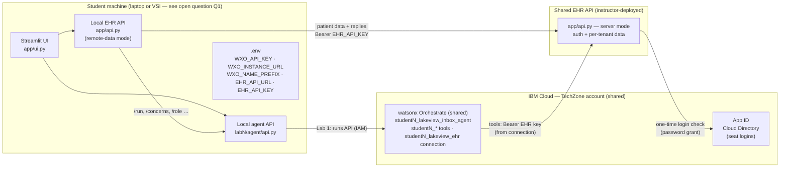
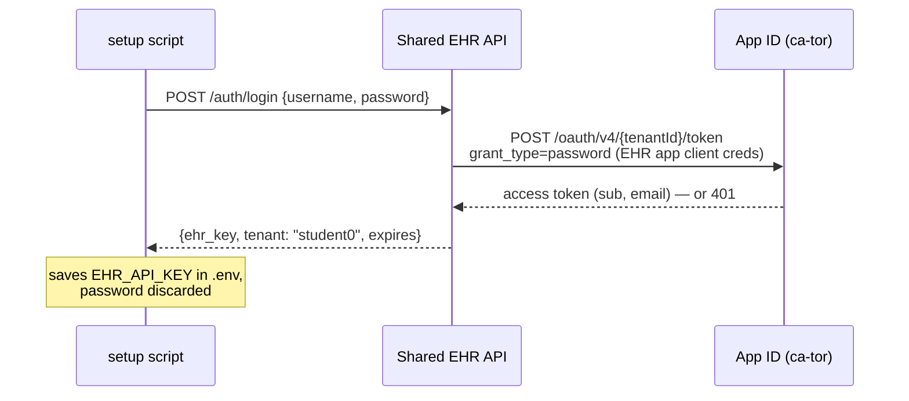

# TXC 2026: student environment and multitenant EHR plan

Branch: `ibm/student-setup` (worktree `.ai-worktrees/ibm-student-setup`), built on `ibm/orchestrate/lab-1` + `main`.
Related: [Lab 1 on Orchestrate findings](2026-10-21-lab1-orchestrate-backend.md).
Status: **plan for review**. Items marked ✅ are built and verified; everything else is proposed.

---

## 1. What we verified (2026-10-22, as seat `student0`)

| Fact | Evidence |
|---|---|
| All ~34 seats (`student0`…) share **one** TechZone deployment in account `itz-enablement-095`, region **ca-tor** | App ID Cloud Directory lists 34 users on one `@6aa171448…techzone.com` domain; one resource group / access group `eid-6aa171448…` |
| Shared services: Orchestrate (`wxo-…`, **Trial/lite** plan), Code Engine project (`ce-…`, empty), watsonx.ai Runtime + Studio, watsonx.governance (Essentials), COS, App ID | `ibmcloud resource service-instances` as student0 |
| Seats can create their own IBM Cloud API keys | IAM policy "User API key creator"; ✅ `scripts/ibm_cloud_login.py` run end to end |
| Seats can deploy agents, tools, connections, plug-ins and **controls** to the shared Orchestrate | ✅ `uv run python -m lab1.agent.deploy` as student0 with prefix `student0_`; patient run returned validated concerns |
| Names (agents, tools, connections) are **global per instance** | Hence the per-seat prefix ✅ (`WXO_NAME_PREFIX`, set automatically by the login script) |
| Seats **cannot** have Code Engine build from source | `ibmcloud ce app create --build-source` fails: CE must assign a registry policy to a service ID, which needs platform **Administrator** on Container Registry; seats have Editor/Manager |
| Container Registry is on the **Free** plan: 512 MB storage, 5 GB pull/month, account-wide | `ibmcloud cr plan` / `cr quota` — per-student images would exhaust it after ~6–8 students |
| Seats are effectively admins of shared things: they can read every trace in the tenant, create/remove controls on any agent, and manage App ID users | Trace API returned all tenant traces; controls bind by agent name; App ID Manager role |

Consequences:

- **Students deploy only to Orchestrate.** No per-student Code Engine apps.
- **One EHR API, deployed once by the instructor, made multitenant**, so each student gets private patient data ("reply → re-run → the concern clears" needs per-student state).

---

## 2. Target architecture



Key properties:

- The student's **local stack is unchanged**: the UI still talks to `localhost`, and lab agents' tools still call `API_URL=localhost`. Only the local EHR API's *data source* switches from `data/patients/*.json` to the shared EHR.
- The **shared EHR** keys every request to a tenant (the seat's username) and keeps a private copy of the 12 synthetic patients per tenant.
- **Orchestrate tools** reach the shared EHR directly with the same per-student key, stored in the student's prefixed connection.

---

## 3. Student flow (what attendees do)

1. **Log in to IBM Cloud** with the instructor's App ID link and the seat's username and password. ✅ documented in the IBM prerequisites.
2. **Create and download an API key** (Manage → Access (IAM) → Manage identities → API keys → Create → Download). ✅ documented.
3. **Run one setup script.** The extended `scripts/ibm_cloud_login.py`:
   1. Reads `~/Downloads/apikey.json`, checks it with IAM, and saves `WXO_API_KEY` and `WXO_NAME_PREFIX`. ✅
   2. Asks for the Orchestrate instance (CRN or URL), checks reachability, and saves `WXO_INSTANCE_URL`. ✅
   3. **New:** asks for the seat's TechZone username and password, then calls `POST {EHR}/auth/login`. The shared EHR verifies them against App ID and returns a **workshop EHR key**. The script saves `EHR_API_URL` and `EHR_API_KEY`. The password is never stored.
   4. **New:** activates an `orchestrate` CLI environment for the seat. This runs `env add` + `env activate`, fed the key on stdin, under the env name `txc`.
4. **Deploy the agent:** `uv run python -m lab1.agent.deploy`. ✅ It creates the prefixed connection, tools, and agent. **Change:** the connection also gets `api_key=<EHR_API_KEY>`.
5. **Start the UI:** `uv run streamlit run app/ui.py`. It auto-starts the local EHR API, which sees `EHR_API_URL`/`EHR_API_KEY` and runs in remote-data mode.

Expected script output:

```text
✓ API key works: student0@…techzone.com (account …)
✓ Saved WXO_API_KEY and WXO_INSTANCE_URL to …/.env
✓ Your agent and tools will be named with the prefix 'student0_'
✓ Orchestrate instance is reachable with this key
✓ Logged in to the Lakeview EHR as student0 — your patient data is ready
✓ Orchestrate CLI environment 'txc' is active
```

---

## 4. Multitenant EHR design

### 4.1 Authentication: TechZone password → App ID → workshop EHR key



- **App ID application:** create a dedicated application, `lakeview-ehr` (type `regularwebapp`), in the TechZone App ID instance (`App ID-itz`, GUID `19a74660-…`). Seats have App ID Manager, so the instructor seat can create it. Its client ID and secret live only in the shared EHR's environment. **Don't reuse "IAM Integration"**: that application backs the IBM Cloud login.
- **App ID password grant** for Cloud Directory users: `POST https://ca-tor.appid.cloud.ibm.com/oauth/v4/{tenantId}/token`, with HTTP Basic client credentials and form data `grant_type=password&username=…&password=…`. *To verify with one real login (task E1).*
- **Workshop EHR key:** a stateless signed token, `tenant` + `exp` + HMAC-SHA256, using a server secret. Restarts don't invalidate keys, and there's no key store. Expiry is set to the end of the event.
- **Tenant:** the local part of the App ID user's email or username, lowercased (`student0`). It matches `WXO_NAME_PREFIX` minus the underscore.
- **Instructor and demo access:** a `--tenant` admin key minted locally with the same secret, for debugging a student's data.

### 4.2 Per-tenant data

- `app/store.py` becomes tenant-aware: `TenantStore(tenant)` holds a deep copy of the 12 synthetic patients, created lazily on the tenant's first request. `save_reply` writes into that tenant's copy.
- **Storage: in memory, single instance** (Code Engine `--min-scale 1 --max-scale 1`). A restart resets every tenant to the pristine dataset. That's acceptable for a 2-hour workshop, and the UI's reset is just "restart". Optional later: snapshot to COS. Seats have COS Administrator; not needed for the event.
- Footprint: 12 patients ≈ a few hundred KB, × 34 tenants is well under 100 MB.

### 4.3 API changes (`app/api.py`)

- **Server mode** (`EHR_MODE=server`, used only by the shared deploy):
  - Every data endpoint requires `Authorization: Bearer <ehr key>` and resolves the tenant from it.
  - The agent-proxy endpoints (`/run`, `/concerns`, `/role`, `/providers`, `/agent/status`, `/grounding`, `/masking`) are **disabled**, because a cloud EHR can't reach anyone's laptop.
  - New: `POST /auth/login`.
- **Remote-data mode** (local, when `EHR_API_URL` + `EHR_API_KEY` are set): data reads and replies are forwarded to the shared EHR with the key. Agent-proxy endpoints work exactly as today.
- **Local mode** (default, nothing set): unchanged. The open-source edition is untouched.

Patient-data call sites that switch: `app/store.py` only, via `load_patients`, `load_patient` and `save_reply`. The lab tools (`labN/agent/tools.py`) and `app/ui.py` need **no** changes, because they call the local API.

### 4.4 Orchestrate tools

- `connection.yaml` / `deploy.py`: set `api_key=<EHR_API_KEY>` next to `base_url` in the student's key-value connection, for both draft and live.
- `lab1/agent/tools.py`: send `Authorization: Bearer {connections.key_value(EHR_APP_ID)["api_key"]}` on every request. This is about 3 lines, plus a teaching comment: the credential lives in a platform connection, not in code or the prompt.

### 4.5 Deploying the shared EHR (instructor, once)

Seats can't build on Code Engine, and the registry is on the Free plan. Options:

| Option | How | Pros | Cons |
|---|---|---|---|
| **A (recommended): instructor's own IBM Cloud account** | `ibmcloud ce app create --build-source . --build-dockerfile deploy/ehr-api/Dockerfile` in the existing `ai-workshop-test` project, the way the current EHR was deployed | Already proven; independent of TechZone quotas and permissions | Runs in a different account from the students (fine: it's just a public HTTPS API); you pay for it (CE free tier likely covers it) |
| B | Build the image once, push it to a public registry (e.g. `ghcr.io/obuzek/lakeview-ehr`), deploy it with `--image` in the TechZone CE project | Everything in one account | Publishes an image; another moving part |
| C | Ask TechZone admins for Container Registry Administrator | Builds work in the TechZone account | Depends on others; Free-plan quota still applies |

Env for the shared app: `EHR_MODE=server`, `EHR_SIGNING_SECRET`, `APPID_TENANT_ID`, `APPID_CLIENT_ID`, `APPID_CLIENT_SECRET`, `APPID_REGION=ca-tor`, `EHR_KEY_EXPIRES=<date>`. Use `--min-scale 1 --max-scale 1`.

---

## 5. Lab 2 PII layering on Orchestrate (status)

| Layer | Mechanism | Protects | Status |
|---|---|---|---|
| Input | **PII Filter control**: `orchestrate controls create -a pii_filter --agent <prefix>lakeview_inbox_agent --hook agent_pre_invoke --config '{…}'` | PII the user types | ✅ verified: the trace shows a `controls.execute agent_pre_invoke` step, "Detected PII item(s), redacted before processing" |
| Output | **Post-invoke plug-in**: `lab2/orchestrate/pii_output_plugin.py` | The answer the user sees | ✅ verified: the trace shows a `mask_pii_output` span; phone, email, DOB and member ID are masked. Names and addresses pass through |
| Source | Return only needed fields from the tools | Model context, traces, answer | To build in the Lab 2 tools |

Verified gaps worth teaching, all visible in traces:

- The PII Filter's `agent_post_invoke` / `tool_post_invoke` hooks are accepted by the CLI but **never execute**: no control step appears in the trace. The upstream `cpex-pii-filter` 0.3.9 only implements prompt and tool hooks, and Orchestrate only lets this control bind to agents.
- Traces keep raw PHI in the tool, LLM and answer-input spans even when the plug-in masks the answer.

Still to wire: deploy-time prefixing for the plug-in name (the same rendering as `tools.py`), and adding a `plugins:` block to the agent spec in the Lab 2 deploy.

---

## 6. Work breakdown (proposed order)

| # | Task | Est. | Verify by |
|---|---|---|---|
| E1 | Create the `lakeview-ehr` App ID application; test a password grant for one seat with a throwaway script (you type the password) | 0.5 h | App ID returns a token for `student0`; 401 for a wrong password |
| E2 | `app/store.py` tenant stores + `app/api.py` server mode (auth, `/auth/login`, signed keys, proxy endpoints off) | 3 h | pytest: two tenants' replies don't leak into each other; bad key → 401; local mode unchanged |
| E3 | Remote-data mode in the local EHR API | 1.5 h | UI against a locally run server-mode EHR: reply → re-run → concern clears |
| E4 | Orchestrate tools send the EHR key; `deploy.py` stores it in the connection | 0.5 h | Patient run as student0 against the shared EHR |
| E5 | Extend `ibm_cloud_login.py` (EHR login + CLI env activation) and update the IBM prerequisites | 1 h | Fresh clone → script → deploy → UI, as student0 |
| E6 | Deploy the shared EHR (option A) | 0.5 h | `curl` with and without a key; `/auth/login` with a seat |
| E7 | **Second-seat test** (`student1`), end to end, in parallel with student0 | 0.5 h | Separate data, no name collisions; check what student1 can see or modify of student0's (traces, controls) |
| E8 | Lab 2 wiring: prefix for the plug-in + control-binding step in the Lab 2 deploy | 1 h | Trace shows both layers for the seat's agent |

---

## 7. Open questions for you

- **Q1. Where do students run the local stack (UI, local APIs, labs)?** This matters most. `environment-topology.md` assumes one TechZone VSI per participant, but the TechZone reservation we probed has **no VSIs**, only shared services. If attendees only have a browser, nothing local can run, and the design needs a hosted UI.
- **Q2. EHR deployment option** (A, B or C above).
- **Q3. Isolation on the shared instance** (deferred to the workspace discussion). Students can read each other's traces, and can create or remove controls on each other's agents. Options: accept and teach it, ask IBM about workspaces (blocked today by `428 TRUSTED_PROFILE_ID is not configured`; Trial allows 1 workspace), or a separate instance per student (cost).
- **Q4.** Seats have App ID **Manager**, so they can likely edit other seats' login accounts. Raise with TechZone?
- **Q5.** The Orchestrate instance is on the **Trial** plan. When does it expire relative to the event?

---

## 8. Test resources currently in the TechZone account (from seat `student0`)

- Orchestrate: agent `student0_lakeview_inbox_agent`, tools `student0_{list_patients,get_patient_record,get_messages,search_labs,get_inbox}`, connection `student0_lakeview_ehr` (points at the instructor's test EHR on Code Engine, us-south).
- An IBM Cloud API key created by student0 (name chosen in the console). Delete it at teardown.
- Already removed: the PII Filter control `student0_pii_test`, the probe agent `student0_pii_probe`, and the plug-in tool `student0_mask_pii_output`.
